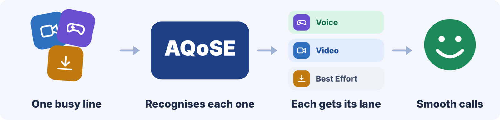
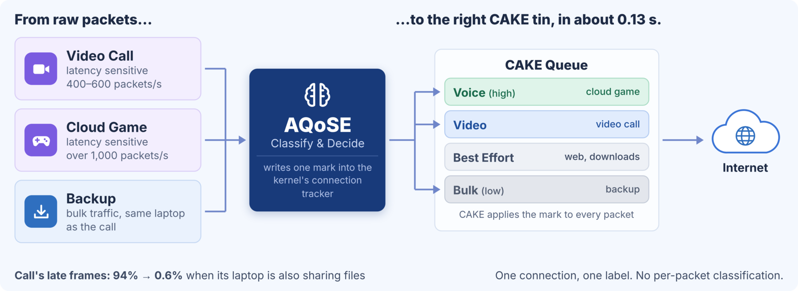
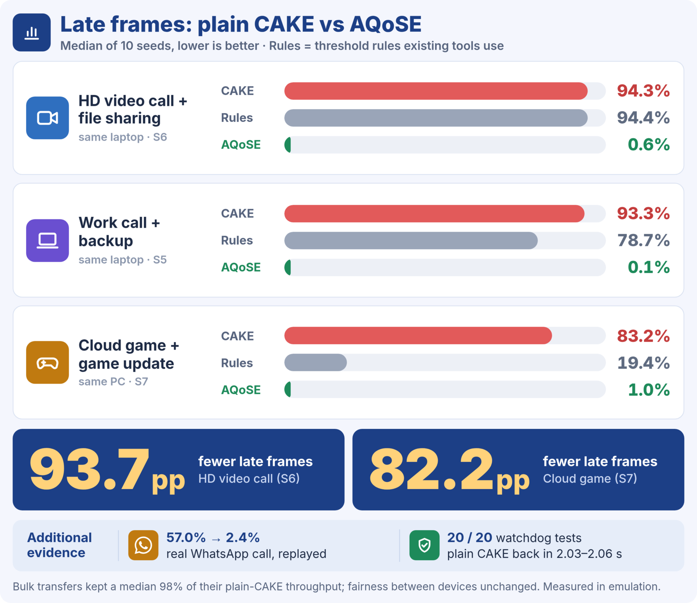
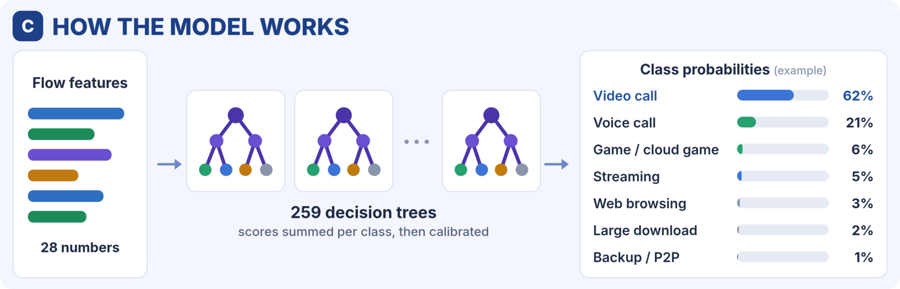
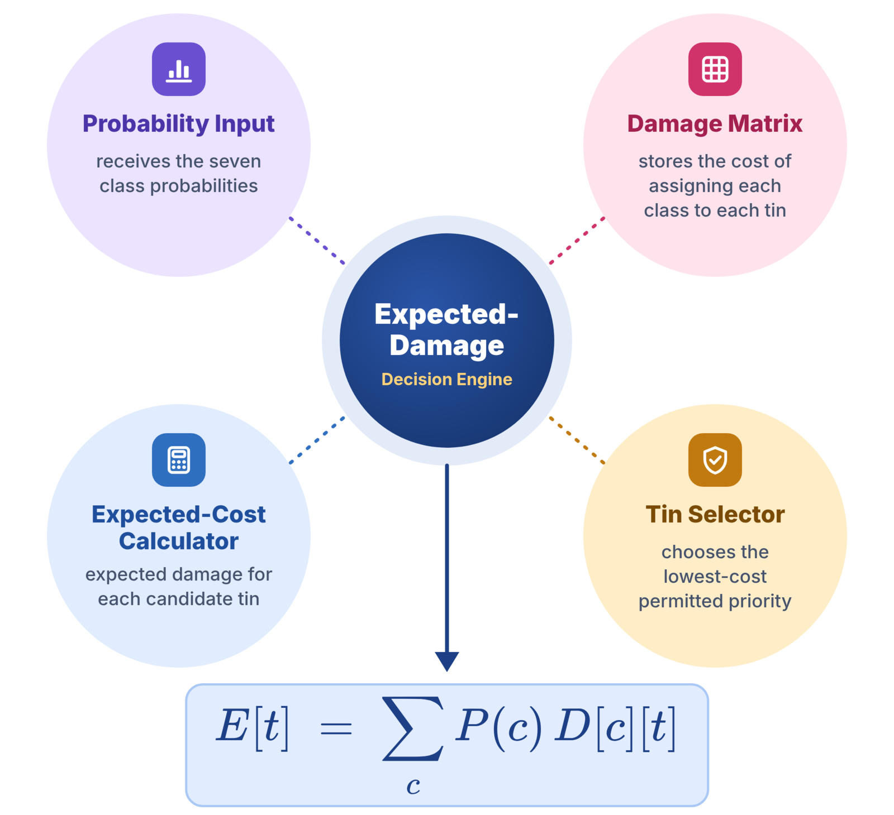
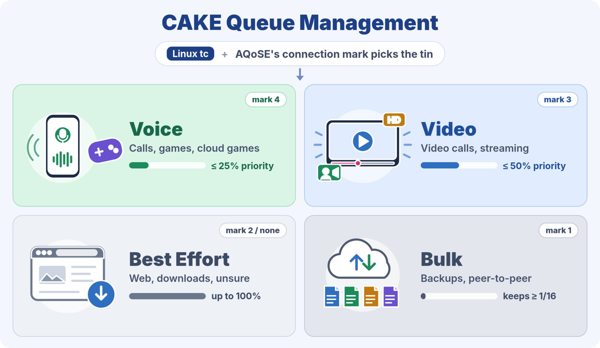
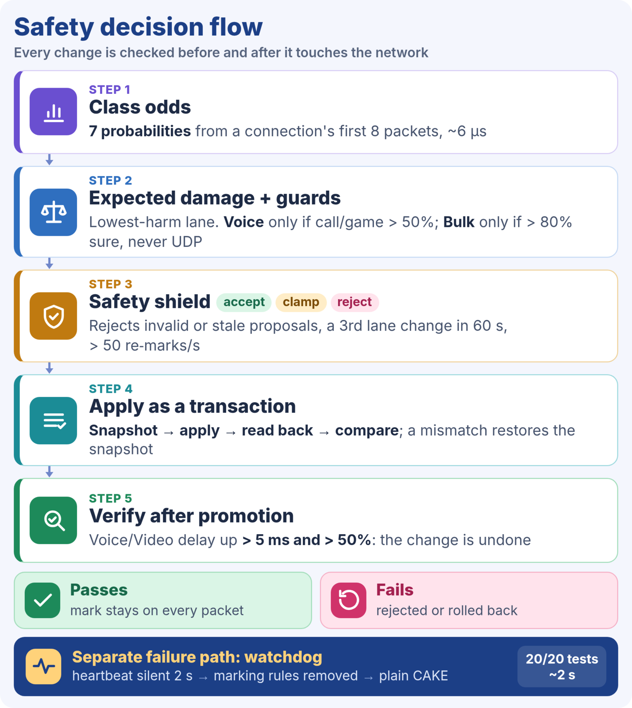
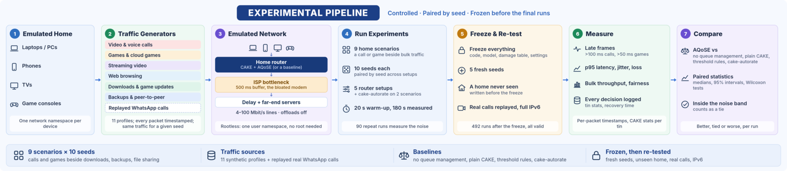
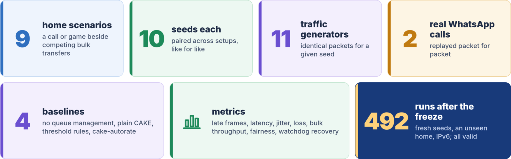
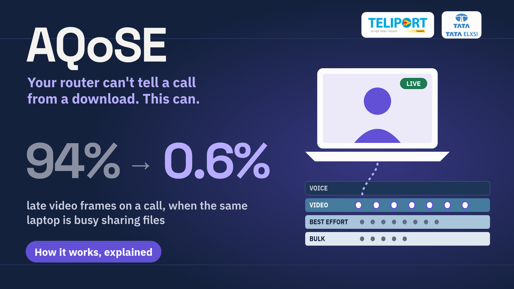

<p align="center">
  
</p>

<h1 align="center">AQoSE · Adaptive QoS Engine</h1>

<p align="center">
  <b>Your router can't tell a video call from a download. AQoSE can.</b><br>
  A small, safety-guarded classifier that tells Linux CAKE which connection is the call or the game,<br>
  from the sizes and timing of its first eight packets: headers only, never content.
</p>

<p align="center">
  <a href="reports/paper/aqose-report.pdf"></a>
  <a href="https://youtu.be/k6ccbBaxwUg"></a>
  
  
  
  
</p>

<p align="center">
  Tata Elxsi <b>Teliport Season 4</b>, Case Study 3 · Team <b>BugHeBug</b>: Shreyash Neeraj, Mridul Jaiswal, Sachi Jha (VIT Bhopal University)
</p>

---

<table>
<tr>
<td width="25%" align="center"><h2>94% → 0.6%</h2>late frames on an HD call while its laptop shares files</td>
<td width="25%" align="center"><h2>0 / 140</h2>paired runs worse than plain CAKE<br>(70 better, 70 tied)</td>
<td width="25%" align="center"><h2>0.13 s</h2>to label a new connection, ~6 µs per classification</td>
<td width="25%" align="center"><h2>~2 s</h2>back to plain CAKE if AQoSE stops, in 20 of 20 kills</td>
</tr>
</table>

<p align="center"><i>All results were measured in emulation, in a rootless network-namespace testbed on one laptop. AQoSE has not yet run on a real router or in a real home.</i></p>

##  The problem

CAKE, the best open-source queue manager on home routers, is fair: first between devices, then between each device's connections. That keeps most calls smooth. It breaks in one everyday situation: **a call or a game on a device that is also downloading, uploading or sharing files.** The call becomes one connection among many, gets a sliver of its own device's share, and nothing tells CAKE it is the call.

- CAKE *can* prioritise, through four priority lanes (tins), but only when packets carry a priority mark. Apps rarely set one, and ISPs often strip it.
- The tools that sort traffic on home routers use fixed thresholds ("many packets per second means bulk"). A video call sends 400–600 packets a second and a cloud game over 1,000, so both get called bulk. qosify's defaults sent **78%** of cloud-gaming flows to the slowest lane.

| With plain CAKE | Late frames |
| --- | --- |
| HD video call on a laptop that is sharing files | **94.3%** |
| Cloud game on a PC fetching a game update | **83.2%** |

##  What AQoSE does

<p align="center"></p>

1. **Listens** to the first 8 packet headers of every new connection. One nftables rule hands them to the controller; no payload, no decryption.
2. **Predicts** what the connection is, with odds for 7 classes: voice call, game / cloud game, video call, streaming, web, large download, backup / P2P.
3. **Decides** the CAKE tin with the lowest *expected damage*, inside hard safety guards.
4. **Writes one label, once,** into the kernel's connection tracker. CAKE applies it to every packet in both directions; AQoSE never touches the packet path.
5. **Watches** every second with a cheap, model-free check, re-asks the classifier only when a flow changes, and rolls back any change that adds delay.

Remove two rules and the system is off. A mark of zero means plain CAKE, by construction.

##  Results

<p align="center"></p>

Median late video or game frames over 10 seeds, frozen system:

| Scenario | Plain CAKE | cake-autorate | Threshold rules | **AQoSE** |
| --- | ---: | ---: | ---: | ---: |
| HD call on a laptop that is sharing files (S6) | 94.3% | | 94.4% | **0.6%** |
| Work call on a busy evening, backup running (S5) | 93.3% | 93.3% | 78.7% | **0.1%** |
| Cloud game on a PC fetching an update (S7) | 83.2% | | 19.4% | **1.0%** |
| Line drops to a fifth of its speed (S2) | 55.5% | 4.6% | 55.6% | **0.9%** |
| Real WhatsApp video call, replayed (S12) | 57.0% | | 42.7% | **2.4%** |

- **Against plain CAKE:** never worse in 140 seed-paired runs (70 better, 70 tied), on the main seeds and on fresh seeds never used in development.
- **Against threshold rules:** never worse in any run. **Against cake-autorate:** better in all 20 runs where both were tested.
- **Nothing starves.** Bulk transfers kept a median 98% of their plain-CAKE throughput; fairness between devices was unchanged (±0.01).
- **Real traffic.** Two recorded WhatsApp calls, replayed packet for packet, were recognised within 0.13 s: late frames 57% → 2.4% and 79% → 14%.
- **Sealed test set**, opened once after the freeze: accuracy 96.9% on 1,213 flows from 183 unseen sessions, but macro-F1 is 0.73 because some classes have only 4–8 test flows. No call or cloud game was sent to Bulk.

##  How it decides

<p align="center"></p>

**The classifier** is LightGBM: 37 boosting rounds for each of 7 classes, 259 trees, calibrated with temperature scaling. It reads 28 numbers: 8 packet sizes signed by direction, the 7 gaps between them, IP version, protocol, the port *class* of each end (never raw port numbers) and 9 window statistics. The trees are exported as data and run in Go, where one answer takes about 6 µs. It was trained on 246,274 records from seven sources, split by capture session, never by record.

<table>
<tr>
<td width="50%" valign="top">

**The decision engine** doesn't just take the top label. A wrong lane doesn't always hurt the same: a call in Bulk is a disaster, a download in Voice mostly harmless. We forced each class into each lane across 240 testbed runs and measured the harm. That is the *damage table*. For each tin, AQoSE weighs the odds by the damage and picks the lowest:

$$E[t] = \sum_{c} P(c)\, D[c][t]$$

Hard guards sit on top: Voice only if call + game > 50%; Bulk only if > 80% sure, never on first packets alone and never for UDP; ties never go to Bulk.

</td>
<td width="50%"></td>
</tr>
</table>

<p align="center"></p>

CAKE does the queuing. AQoSE only picks the tin: Voice has priority up to 25% of the line, Video up to 50%, Best Effort up to 100%, and Bulk always keeps at least a sixteenth so nothing is starved.

##  Built to fail safe

<table>
<tr>
<td width="38%"></td>
<td width="62%" valign="top">

Every change, from any part of the system, passes the same checks:

- **Safety shield**: a pure function. It rejects invalid or stale proposals, a third lane change for one flow within 60 s, and more than 50 re-marks a second; it clamps rate changes to safe steps. Go's fuzzer threw 10.9 million generated proposals at it with no violation, and six planted bugs were each caught in under a second.
- **Transactions**: snapshot, apply, read back, compare. A mismatch restores the snapshot.
- **QoE verifier**: after a promotion, if Voice/Video delay rose by more than 5 ms *and* more than half, the change is undone.
- **Watchdog**: a separate process. If the controller's heartbeat goes quiet for 2 s, it removes the marking rules and restores plain CAKE. In 20 of 20 kills that took 2.03–2.06 s.
- **Every decision is logged** with a plain-English reason, e.g. *"Looks like a video call (62% confident); the Video tin has the lowest expected damage."*

</td>
</tr>
</table>

##  How it was tested

<p align="center"></p>

<p align="center"></p>

- A **rootless testbed** on one laptop: a network namespace per device, a router, and an ISP bottleneck with a bloated 500 ms buffer. No `sudo`.
- **Eleven traffic generators** with per-packet timestamps. A frame is late if it arrives more than 100 ms late for a call, or 50 ms for a game.
- **Nine home scenarios × five router setups × ten seeds** (plus cake-autorate on two scenarios), paired by seed so every setup sees byte-identical traffic. Ninety A/A runs measured the noise; a difference inside it counts as a tie.
- **Then we froze everything**: code, model, damage table and settings. We re-ran on fresh seeds, a home it had never seen, replayed real WhatsApp calls and full IPv6. All 492 runs after the freeze were valid.

## What we haven't shown

- **Emulation only.** No real router, no Wi-Fi, no real homes yet.
- **Generated calls don't adapt** their bitrate under pressure the way real apps do. The replayed WhatsApp calls are real traffic, but the app wasn't running.
- **The model is weaker on data sources it has never seen**, and some classes are thin in the test set.
- **Two known problems:** a cloud game above a quarter of the line outgrows the Voice tin, and the line estimator overreacts when its probes return after an outage.

**Next:** run on a real OpenWrt router, test live with real apps, then a field trial in volunteer homes. The [report](reports/paper/aqose-report.pdf) lists every limitation.

##  Quick start

Linux with CAKE, nftables and user namespaces; Go 1.26 and Python 3.14. Versions are pinned in [VERSIONS.md](VERSIONS.md).

```bash
make venv    # create .venv from requirements.lock
make env     # compare this machine against VERSIONS.md
make check   # Go vet and tests, Python tests (about a minute)
make build   # binaries into bin/

scripts/demo.sh   # the whole loop in ~8 minutes, no sudo: S6 with plain CAKE, then with AQoSE, side by side
```

<p align="center">
  <a href="https://youtu.be/k6ccbBaxwUg"></a><br>
  <sub>Watch the explainer: a 2–3 minute overview, then a detailed walkthrough.</sub>
</p>

---

<details>
<summary><b>Reference: testbed, experiments, dataset, training and repository layout</b></summary>

### Documents

- [Full report](reports/paper/aqose-report.pdf) ([LaTeX source](reports/paper/aqose-report.tex))
- [Project log](<Project Log.md>): what was done, why, what was measured, what is next
- [Product requirements](<Adaptive QoS Engine Product Requirements (Teliport S4).md>)
- [Build plan](<Build Plan and Timeline.md>)
- [Technical specification](<Technical Specification.md>)
- [Interface contracts](contracts/README.md)
- [Pinned versions](VERSIONS.md)
- [Explainer video sources](reports/video/README.md)

### Testbed

No `sudo` is needed.

```
bin/aqos-testbed up contracts/examples/scenario.S1.yaml
bin/aqos-testbed exec host-laptop -- ping -c 3 10.78.0.10
bin/aqos-testbed check-rate
bin/aqos-testbed event link_rate direction=down rate_kbit=20000
bin/aqos-testbed down

make testbed-check   # builds the testbed and runs traffic, runs, the extractor and the controller through it
```

### Running an experiment

```
PYTHONPATH=ml .venv/bin/python -m aqos_ml.run one --scenario S1 --config B2 --seed 7
PYTHONPATH=ml .venv/bin/python -m aqos_ml.run one --scenario S6 --config O2 --seed 7   # with the controller
PYTHONPATH=ml .venv/bin/python -m aqos_ml.run matrix configs/matrix-3a.yaml   # resumes where it stopped
PYTHONPATH=ml .venv/bin/python -m aqos_ml.run show results/S1-B2-s0007
```

Configurations: `B0` no QoS, `B2` plain CAKE, `B4` threshold rules, `O1` the model deciding by top label, `O2` the model deciding by expected damage. The last three start the ML service and the controller (`aqosd`) in the router; `O1` and `O2` need a trained model.

Results land in `results/<run_id>/`. A controller run also writes `actions.jsonl` (every proposal, the shield's verdict and what became of it) and `controller.json` (counts). To watch a run live: `bin/aqos-exporter` and `docker compose -f dashboards/compose.yaml up -d`.

### Driving the router by hand

Inside a testbed with CAKE set up (`bin/aqos-testbed exec router -- configs/baselines/B2.sh 100000 20000`):

```
bin/aqos-testbed exec router -- bin/aqos-ctl marking install
bin/aqos-testbed exec router -- bin/aqos-ctl flows
bin/aqos-testbed exec router -- bin/aqos-ctl label udp 10.77.0.10:41000 10.78.0.10:7000 voice
bin/aqos-testbed exec router -- bin/aqos-ctl rate down 50000
bin/aqos-testbed exec router -- bin/aqos-ctl tins
```

### Dataset

```
PYTHONPATH=ml .venv/bin/python -m aqos_ml.dataset scenarios                       # 48 training scenarios
PYTHONPATH=ml .venv/bin/python -m aqos_ml.run matrix scenarios/train/matrix.yaml --results results-train
PYTHONPATH=ml .venv/bin/python -m aqos_ml.dataset build                           # data/dataset/v1.jsonl.gz
```

Public datasets come in as flow tables made on Kaggle (`kaggle/`), under `data/public/`.

### Model, damage table, comparison

```
PYTHONPATH=ml .venv/bin/python -m aqos_ml.train --dataset data/dataset/v1.jsonl.gz     # random forest and LightGBM, into models/
PYTHONPATH=ml .venv/bin/python -m aqos_ml.compare --dataset data/dataset/v1.jsonl.gz   # models against rules: reports/head-to-head-*.md
PYTHONPATH=ml .venv/bin/python -m aqos_ml.damage run --seeds 1-3                       # measure the damage table (hours; resumable)
PYTHONPATH=ml .venv/bin/python -m aqos_ml.damage score                                 # configs/damage_table.measured.yaml
make fuzz                                                                              # the safety shield's fuzz tests
```

### Feature records from a capture

```
bin/aqos-extract -pcap capture.pcap -out features.jsonl -keys keys.jsonl
```

### Layout

| Path | Contents |
| --- | --- |
| `contracts/` | Schemas, examples and Go types shared by Systems and ML |
| `cmd/aqos-testbed`, `internal/testbed` | The emulated home network |
| `internal/extract`, `internal/netfilter`, `internal/capture`, `cmd/aqos-extract` | Feature extractor, offline and live |
| `internal/cake`, `internal/exporter`, `configs/baselines/`, `dashboards/` | Baselines and metrics |
| `ml/aqos_ml/run` | Experiment runner |
| `ml/aqos_ml/dataset` | Dataset builder |
| `ml/aqos_ml/rules.py`, `ml/aqos_ml/evaluate.py` | Threshold rules and the shared scoring code |
| `internal/enforce`, `cmd/aqos-ctl` | Enforcer |
| `cmd/aqos-watchdog`, `internal/heartbeat` | Watchdog |
| `ml/aqos_ml/features.py`, `train.py`, `model.py`, `serve.py` | Classifier and the ML service |
| `ml/aqos_ml/damage.py`, `configs/damage_*.yaml` | Damage table, measured |
| `ml/aqos_ml/decide.py` | Decision engine |
| `internal/shield`, `configs/shield.yaml` | Safety shield |
| `cmd/aqosd`, `internal/controller` | The controller |
| `ml/aqos_ml/compare.py` | Models against rules, the go/no-go report |
| `ml/aqos_ml/gen` | Traffic generators |
| `ml/aqos_ml/capture.py` | Recording and reviewing real-app captures |
| `scenarios/` | Scenario files |
| `kaggle/` | Reducing public datasets to flow tables |
| `ml/tests/` | Python tests |
| `scripts/` | Environment check, data fetching, the demo, the frozen-system runs |
| `reports/` | The report, result summaries and charts, the one-slide and round-1 slides, the explainer video's sources |
| `docs/images/` | Figures used in this README |

</details>
