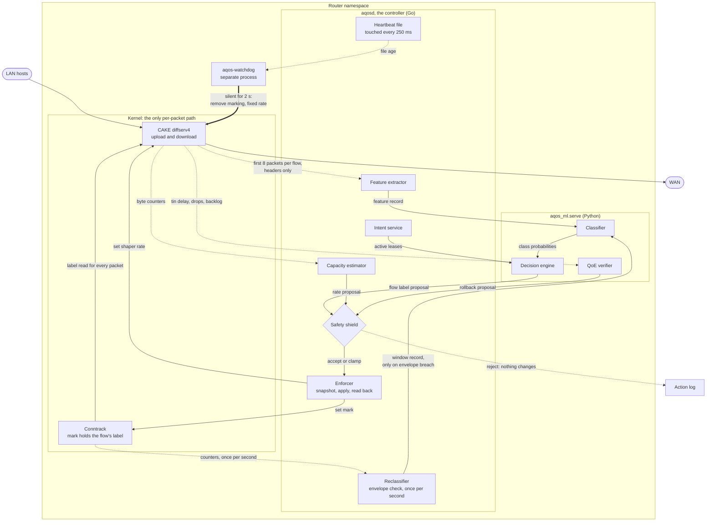

# Adaptive QoS Engine: Technical Specification

Oct 9, 2026

This document says how each part of the system is built. The [PRD](<Adaptive QoS Engine Product Requirements (Teliport S4).md>) says what and why; the [build plan](<Build Plan and Timeline.md>) says in what order and who. Chunk numbers (1A to 9B) come from the build plan, module numbers (M1 to M14) from the PRD.

**How to read the status labels**

| Label | Meaning |
| --- | --- |
| Built | In the repo and passing `make check` |
| Verified | Not built, but the mechanism was tried on the reference laptop and works |
| Proposed | A design to build against. The owner may change it when the chunk starts, as long as the contracts still hold |

All numbers marked "starting value" are configuration, not constants. They are first guesses to be tuned in the testbed and published with the results.

## 1. System at a glance

A packet's first eight headers go to the extractor, the classifier turns them into probabilities, the decision engine picks a tin, the shield checks the proposal, and the enforcer writes one conntrack mark. From then on CAKE reads that mark for every packet of the flow and nothing else runs per packet.



Solid arrows carry decisions, dotted arrows carry observations, and the thick arrow is the fail-safe. Every arrow that changes CAKE or a mark starts at the enforcer or the watchdog.

### 1.1 Processes

| Process | Language | Runs in | Owner | Role |
| --- | --- | --- | --- | --- |
| `aqos-testbed` | Go | Host | Systems | Builds and tears down namespaces, links and impairments from a scenario file |
| `aqosd` | Go | Router namespace | Systems | The controller: extractor, flow table, shield, enforcer, capacity estimator, envelope checks, intent API, heartbeat |
| `aqos-watchdog` | Go, standard library only | Router namespace | Systems | Applies the safe CAKE configuration when the controller stops |
| `aqos-extract` | Go | Host | Systems | Offline: turns a pcap into feature records with the same code `aqosd` uses |
| `aqos_ml.serve` | Python | Router namespace | ML | Local service: classify, decide, verify |
| `aqos_ml.gen` | Python | Host and server namespaces | ML | Traffic generators and their servers |
| `aqos_ml.run` | Python | Host | ML | Experiment runner |
| `aqos_ml.train`, `aqos_ml.report` | Python | Host | ML | Training, statistics, charts |
| `aqos-exporter` | Go | Host | Systems | Tails the current run's `metrics.jsonl` and serves it to Prometheus |
| Prometheus, Grafana | Containers | Host | Systems | Dashboard |

### 1.2 Planned repository layout

```
cmd/            aqos-testbed, aqos-extract, aqos-cake-reader, aqos-exporter, aqos-ctl, aqos-watchdog, aqosd, aqos-reflector (built)
internal/       testbed, extract, netfilter, capture, cake, exporter, runclock, enforce, heartbeat, shield, controller, capacity, intent (built); envelope
contracts/      schemas, examples, Go types, taxonomy          (built)
ml/aqos_ml/     gen, capture, run, dataset, rules, evaluate, features, train, model, serve, decide, damage (built); verify, report
kaggle/         script and notebook that reduce public datasets to flow tables
ml/tests/       Python tests for ml/aqos_ml
scenarios/      S1.yaml (built) ... S10.yaml; train/ (48 randomised scenarios for training data)
configs/        baselines/ (B0, B2 built), matrix files, shield.yaml, damage_scoring.yaml, damage_table.yaml (placeholder until the measured one is adopted)
dashboards/     Grafana provisioning and dashboard JSON, compose file
models/         one directory per trained model version
results/        one directory per run                           (git-ignored)
data/           captures and datasets                           (raw data git-ignored)
```

### 1.3 Rules that apply everywhere

- **Unknown means Standard.** Any error, timeout, overflow or missing answer leaves the flow unlabelled. An unlabelled flow has conntrack mark 0, and CAKE then picks the tin from the packet's own DSCP, which is exactly plain CAKE.
- **Nothing reaches CAKE except through the shield and the enforcer.** No other code runs `tc` or changes marks.
- **Every change has a reason string** and is logged whether it was accepted, clamped or rejected.
- **One clock.** All namespaces on one machine share `CLOCK_MONOTONIC`. Live records use it in nanoseconds; run-relative times are seconds since the start of warm-up.
- **Configuration is files, not code.** Thresholds, the damage table, shield bounds and rates live in `configs/` and are copied into each run's result directory.

## 2. Done: wave 1

### 2.1 Chunk 1A: versions and repository (Built)

- Git repository on branch `main`, nothing committed yet.
- Go module `adaptiveqos`, Go 1.26. One third-party Go dependency, `gopkg.in/yaml.v3` 3.0.1, added in chunk 2A to read scenario files.
- Python 3.14 virtual environment in `.venv`. `requirements.txt` pins direct dependencies; `requirements.lock` pins the full resolved set and was confirmed to reproduce exactly in a fresh environment.
- [VERSIONS.md](VERSIONS.md) records every pinned version, including Grafana 13.2.3 and Prometheus 3.15.0 by container tag.
- `make env` runs `scripts/check-env.sh`, which fails on a missing required tool, a version mismatch, a missing kernel module or a virtual environment that differs from the lock file.
- `make check` runs `gofmt`, `go vet`, the Go tests and the Python tests (contracts and `ml/tests`). It takes about 35 s, most of it the generators running against each other on localhost.
- `make testbed-check` builds the real testbed and runs traffic through it. It replaces any running testbed and takes about a minute, so it is separate.

Open: the second laptop has not been checked, and three optional tools are not installed (`conntrack-tools`, `iperf3`, `irtt`).

### 2.2 Chunk 1B: interface contracts (Built, awaiting agreement from ML)

Seven JSON Schemas, one example per schema, Go types and a shared taxonomy, all in [contracts/](contracts/). [contracts/README.md](contracts/README.md) is the reference; this section only lists what later chunks rely on.

| Contract | Used by chunks |
| --- | --- |
| Scenario | 2A, 2B, 3C, 6C |
| Feature record | 3B, 4A, 5A, 7A |
| Classification | 4B, 5A, 5C, 6A |
| Policy proposal | 5C, 5D, 6A, 7A, 7C, 7D |
| Policy verdict | 4C, 5D, 5E |
| Metric sample | 2B, 3A, 3C, 5E, 9A |
| Run manifest | 3C, 9A |

How drift is prevented: the Python test validates every example against its schema and checks that the schemas' enumerations match `taxonomy.json`; the Go test decodes the same example files with unknown fields disallowed. A change to one side that the other does not follow fails `make check`. There are 42 Python test cases, 19 of which are deliberately invalid records that must be rejected.

### 2.3 Mechanisms verified on the reference laptop

These were tried inside a rootless namespace (`unshare -Urn`) on kernel 7.2.8 with iproute2 6.14.0 and nftables 1.1.3. They shape the designs below.

| Mechanism | Result |
| --- | --- |
| `cake bandwidth … diffserv4 dual-srchost nat fwmark 0x7` on an egress interface | Attaches |
| `cake … dual-dsthost nat ingress fwmark 0x7` on an IFB device | Attaches |
| `tc qdisc change dev … root cake bandwidth …` | Changes the rate in place |
| `tc -j qdisc show` | Reports `options.bandwidth` in bytes per second (15000 kbit reads back as 1875000) |
| `tc -j -s qdisc show` on CAKE | Four tins, each with `avg_delay_us`, `peak_delay_us`, `backlog_bytes`, `drops`, `sent_bytes`, `sparse_flows`, `bulk_flows` |
| Ingress qdisc with `action ctinfo cpmark 0x7 action mirred egress redirect dev ifb0` | Attaches |
| `action ctinfo dscp 0xfc000000 0x01000000` | Attaches |
| `tbf` replace and change; `netem delay … loss …` | Work |
| `sysctl net.netfilter.nf_conntrack_acct=1` inside a namespace | Works |
| nftables: `ct packets < 9 log group 5 snaplen 64` | Accepted |
| nftables: `meta mark set ct mark and 0x7` | Accepted |
| nftables: a map keyed on the 5-tuple setting `ct mark` | Accepted |
| nftables: `ip dscp set` from a map on `ct mark` | Rejected ("payload statement for this expression is not supported") |
| nftables: one explicit `ip dscp set` rule per mark value | Syntax accepted, but the rootless namespace returned "Operation not permitted" |

Checked in chunk 2A, inside the rootless testbed with real traffic:

| Mechanism | Result |
| --- | --- |
| nflog: `ct packets < 9 log group 5 snaplen 64` in the router's forward chain, read with `tcpdump -i nflog:5` | Exactly the first 8 packets of a 20-packet flow were delivered |
| Conntrack mark update over netlink (`IPCTNL_MSG_CT_NEW` with `CTA_MARK` on an existing entry) | Acknowledged; a rule matching `ct mark 4` counted the flow's next packets and none before |

Chunk 3B then confirmed nflog delivery to a Go listener, and reading conntrack's per-flow counters over netlink, both rootless.

That a packet with a given mark lands in the expected CAKE tin was the last unverified piece. Chunk 4C confirmed it: see section 6.3.

## 3. Marking design

This section is cross-cutting: the enforcer, the baselines, the watchdog and the testbed all depend on it.

**Status: Proposed, with the pieces in section 2.3 verified.**

### 3.1 The conntrack mark is the label

A flow's label is stored in the low three bits of its conntrack mark.

| Mark value (`ct mark & 0x7`) | Meaning | CAKE tin |
| --- | --- | --- |
| 0 | Unlabelled | Chosen by CAKE from the packet's DSCP |
| 1 | Low priority | Bulk |
| 2 | Standard or high-throughput | Best Effort |
| 3 | Conferencing or streaming | Video |
| 4 | Telephony or real-time interactive | Voice |

The values assume CAKE's `fwmark` option maps a masked mark of n to tin n, counting from 1, with `diffserv4` tins ordered Bulk, Best Effort, Video, Voice. Chunk 4C must confirm this with a test that sends marked traffic and reads the per-tin counters. The other 29 bits of the mark are left alone.

### 3.2 How the mark reaches CAKE

- **Upload.** A postrouting rule copies the label to the packet: `meta mark set ct mark and 0x7`. CAKE on the WAN interface runs with `fwmark 0x7`.
- **Download.** Packets arriving on the WAN interface are redirected to an IFB device. The same filter restores the label first: `action ctinfo cpmark 0x7`. CAKE on the IFB device runs with `fwmark 0x7`.

### 3.3 Difference from the PRD

The PRD describes selecting the tin by rewriting DSCP and restoring DSCP on ingress with `ctinfo`. This design selects the tin from the mark directly and treats DSCP rewriting as secondary. The reasons:

- Mark 0 falls through to CAKE's normal DSCP handling, so "unlabelled equals plain CAKE" is true by construction, with no rule to get wrong.
- Removing two rules turns the whole system off. That is what the watchdog needs.
- Setting DSCP from the conntrack mark with a map is not supported by this nftables version, and the per-value form could not be confirmed without root.

DSCP rewriting toward the LAN (useful for Wi-Fi WMM on real hardware) remains possible with one explicit rule per mark value. It is not needed in the testbed and is out of scope until chunk 4C confirms it with root.

Policy proposals still carry a `dscp` field, as the contract requires. The enforcer uses `tin` to choose the mark and records `dscp` in the log.

### 3.4 How the mark is written

The controller updates the conntrack entry's mark directly over netlink, one operation per label change. No per-packet lookup is added, which matches the PRD's scalability claim.

Fallback if netlink updates prove unreliable: an nftables map keyed on the 5-tuple with a timeout, and a forward-chain rule that sets `ct mark` from it. The syntax for this was verified.

## 4. Wave 2: ground

### 4.1 Chunk 2A: testbed (M1, Systems, Built)

**Topology.** One namespace per LAN host, plus four fixed ones.

```
host-laptop ─┐
host-desktop ─┼─ br-lan [router] wan0 ── [isp] ── [core] ── [server]
host-tv1 ────┘                            rate     delay
```

| Namespace | Purpose |
| --- | --- |
| `host-<name>` | One per entry in the scenario's `hosts` |
| `router` | The device under test. LAN bridge, WAN interface, NAT for IPv4, routing for IPv6, CAKE, the controller |
| `isp` | The bottleneck. Rate limit in both directions with a deep FIFO, standing in for the modem |
| `core` | Delay, jitter and loss in both directions |
| `server` | Generator servers and delay reflectors |

Rate and delay sit in separate namespaces so that a token bucket and a netem qdisc are never stacked on one interface.

**Bottleneck.** `tbf` on each egress of `isp`, with a buffer worth 500 ms at the link rate (starting value). This is the "bloated FIFO" of configuration B0 and is present in every configuration; only what the router does differs.

**Addressing.** IPv4 `10.77.0.0/24` on the LAN with masquerade on `wan0`; IPv6 unique-local prefixes routed without NAT. Both are checked with ping on `up`.

**Commands.**

| Command | Effect |
| --- | --- |
| `aqos-testbed up <scenario.yaml>` | Tears down any earlier testbed, builds this one, enables conntrack accounting in `router`, checks ping4 and ping6 |
| `aqos-testbed down` | Removes every namespace and link it created. Safe to run twice |
| `aqos-testbed event <type> <args>` | Applies one scenario event, for example a link rate change |
| `aqos-testbed exec <namespace> -- <command>` | Runs a command inside a namespace |

All names carry an `aqos-` prefix so teardown can find and remove leftovers from a crashed run.

**Privileges.** CAKE and the tc filters attach in a rootless namespace, but at least one nftables operation was refused there. `up` therefore starts by probing what it needs and asks for `sudo` only if the probe fails. Whichever mode is used is written to the run manifest.

**Noise control.** Router softirq work, generators and the controller are pinned to separate CPU cores with `taskset`; the CPU governor is set to performance for a matrix run. The reference laptop has 16 cores.

**Done when.** ping4 and ping6 pass; a bulk transfer measures the bottleneck within 3% of the configured rate in both directions; `down` after a killed `up` leaves nothing behind.

**As built.** Code is in `cmd/aqos-testbed` and `internal/testbed`. Where it differs from the design above:

- **No `sudo` and no probe.** Everything the testbed and the later chunks need was found to work rootless (section 2.3), so there is one mode: `up` creates one user namespace and every network namespace inside it. The mode is in `aqos-testbed status`, for the runner to record.
- **Under `sudo` it does not work**, and does not need to. Tried once on the reference laptop: starting the first holder fails with "permission denied". Not investigated, since nothing requires root.
- **Namespaces are held by processes, not named.** `ip netns add` needs root to mount under `/run/netns`. Instead each namespace is kept alive by a holder process (`aqos-testbed _hold aqos-<name>`), and veth ends are moved by holder pid. `ip netns list` therefore shows nothing; use `aqos-testbed exec <namespace> -- <command>`. Teardown finds holders by scanning `/proc`, not from a state file, which is what makes `down` work after a killed `up`. It also kills any process still running inside a namespace.
- **Addresses.** LAN `10.77.0.0/24` and `fd77:0:0:1::/64`, router `.1`, hosts from `.10` in scenario order. Server `10.78.0.10` and `fd77:0:0:4::2`. `status` prints them as JSON.
- **Bottleneck.** `tbf` with a burst of 1 ms at the link rate (at least two frames) and a FIFO of 500 ms.
- **Offloads are off** (`tso`, `gso`, `gro`) on every veth. With them on, the router would see packets far larger than any real link carries, and first-packet sizes would be wrong.
- **Conntrack for IPv6.** The NAT table only makes the kernel track IPv4. A second table with one `ct state new counter` rule makes it track IPv6 flows too, so they can carry a label later.
- **Events.** `event` takes `key=value` arguments, the same keys as a scenario event's `args`: `link_rate direction=up|down rate_kbit=N` and `link_impair [delay_ms=N] [jitter_ms=N] [loss_pct=N]`. Other event types belong to other chunks and are refused.
- **Rate check is its own command**, `aqos-testbed check-rate`, not part of `up`, because it takes 15 s. It fills the link with one TCP flow per direction and compares the bytes the bottleneck interface transmitted with the configured rate. Both count whole frames, so the figure is the rate on the wire; TCP goodput is about 4% lower. It flushes the kernel's per-destination TCP metrics first: without that, a second check starts with the first one's slow-start threshold and reads up to 9% low.
- **Noise control is partly done.** `exec -cpus <list>` pins a command. Which process goes on which core is the runner's decision (3C), and the CPU governor needs root, so neither is set here.
- **Jitter reorders.** netem applies jitter per packet, so `jitter_ms` above zero also reorders packets within a flow. Scenarios that only want delay should leave it at zero.

**Measured on the reference laptop.** `up` takes 2.4 s for two hosts. Bottleneck error on S1's link: 0.00% up (20 Mbit/s) and 0.00% down (100 Mbit/s), repeatable to within 0.01%. Ping round trip is 20.4 ms for a 10 ms one-way delay.

### 4.2 Chunk 2B: traffic generators (M2, ML, Built)

Each profile is a client in a host namespace and a server in the `server` namespace. The runner starts both with the scenario's traffic entry and a seed.

| Profile | Transport | Shape (starting values, randomised for training) | QoE written |
| --- | --- | --- | --- |
| `voice_call` | UDP, both ways | One packet every 20 ms, 100 to 200 bytes | latency, jitter, loss |
| `video_call` | UDP, both ways | 30 frames per second, 1 to 2.5 Mbit/s, frames split into packets of at most 1200 bytes, plus an audio stream | latency, jitter, loss, frame misses |
| `gaming` | UDP, both ways | 30 to 128 updates per second, 50 to 200 bytes | latency, jitter, loss, frame misses |
| `cloud_gaming` | UDP | Down: 60 frames per second at 10 to 25 Mbit/s. Up: small input packets at 125 per second | latency, jitter, loss, frame misses |
| `abr_video` | TCP | Segments of 2 to 4 s from a bitrate ladder, buffer-based adaptation | stall time, selected bitrate, throughput |
| `web_browsing` | TCP | Bursts of short flows with think time | throughput |
| `bulk_download` | TCP | One or more greedy connections | throughput |
| `game_update` | TCP | Several parallel greedy connections | throughput |
| `backup_upload` | TCP | Greedy upload | throughput |
| `p2p` | TCP and UDP | Many concurrent flows, both directions | throughput |
| `flow_storm` | TCP and UDP | Short flows at a set number of new flows per second | flows opened |

**Measurement.** Every generator datagram carries a sequence number and a send timestamp from the shared monotonic clock, so one-way latency is exact. This is the generators' own payload; the extractor never reads it. A frame misses when its last packet arrives later than the frame deadline (starting value 100 ms for calls, 50 ms for gaming).

**Determinism.** Each traffic entry draws from its own random generator seeded with the run seed and the entry's id. The send schedule is computed before the run starts, so the same seed gives the same schedule regardless of load.

**Ports.** Client and server ports are randomised per run. If they were fixed, the model would learn ports instead of behaviour.

**Ground truth.** Each generator writes the 5-tuples it used, with its traffic id and profile, to `flows.jsonl` in the run directory. The dataset builder uses it for labels.

**Failure.** A generator that exits with an error makes the run invalid. It is recorded in the manifest and retried, never dropped.

**Risk.** Python may not hold timing at cloud-gaming packet rates (about 2,600 packets per second at 25 Mbit/s). The check is to compare scheduled and actual send times under load; if the error is large, the UDP sender for that profile moves to Go.

**Done when.** The same seed gives the same schedule, every profile writes valid metric samples, and a crashed generator produces an invalid run.

**As built.** Code is in `ml/aqos_ml/gen`. All eleven profiles exist.

- **Commands.** `python -m aqos_ml.gen server|client --scenario F --traffic-id ID --seed N --run-id R --t0-ns T --out DIR [--server4 A] [--server6 A]`. One server and one client per traffic entry. `--t0-ns` is the `CLOCK_MONOTONIC` time at which the run's clock reads zero; `gen t0` prints one. `gen plan` prints each entry's parameters, ports and digest. `gen check` exits non-zero unless every generator finished cleanly.
- **The plan.** Everything an entry will do is a pure function of the scenario, the entry id and the seed. Client and server each compute it, so neither tells the other what to send. Each plan has a digest; equal digests mean identical traffic. An entry's random draws depend only on the seed and its own id, so adding or removing another entry does not change it.
- **Parameters.** A parameter left out of the scenario's `params` is drawn from the range in the table above; one that is given is used as is, without shifting the draws of the others. The names are listed in [contracts/README.md](contracts/README.md). An unknown name is an error.
- **Ports.** Every entry gets a server port and a client port between 20000 and 60000, all distinct, drawn from the seed.
- **Output.** Generators append straight to the run's `metrics.jsonl` and `flows.jsonl`, one whole line per write, so no merge step is needed. Each also writes `gen/<traffic_id>.<role>.json` as its last act: status, parameters, plan digest, counts and send-timing error.
- **A crash is a missing summary.** A generator that dies leaves no summary; one that is stopped early or fails writes `status: error` and exits non-zero. `aqos_ml.gen.validate.check` turns either into a list of reasons, which is what the runner needs for `valid: false`. A UDP client that never hears from its server, and a TCP client that cannot connect, both fail.
- **No handshake of our own.** The UDP server starts sending when the client's first packet arrives, on the next frame boundary, as it would behind any NAT. Nothing is added to the first packets of a flow that a real application would not send.
- **Loss** is counted from sequence numbers per second. A second in which nothing at all arrives, while packets were due, is reported as total loss.
- **Frame misses** use the frame's scheduled send time plus the deadline, so a sender that is late counts against the frame. Frames due before the two ends first reached each other are not counted.
- **`frame_miss` carries a direction**, because each end measures the frames it receives. The contract table listed it without one; the schema allows it. See section 14.
- **`flow_storm` has no QoE metric in the contract.** Flows opened, unanswered and failed are in its summary file. A flow that fails under a storm is counted, not fatal.
- **TCP profiles share one small protocol.** A connection opens with one JSON line asking the server to send N bytes, or to receive. This stands in for an HTTP request; the extractor sees its size and timing like any other first packet.
- **`traffic_param` events are not handled yet.** S8's camera, lobby and pause changes arrive with the scenario definitions in 6C, and will be folded into the plan so that it stays computed before the run.

**The timing risk is settled.** Through the testbed at 25 Mbit/s, the cloud-gaming sender averaged 2,600 packets per second for 21 s with a send-time error of 55 µs mean, 113 µs at the 99th percentile and 2.6 ms worst case, and every frame arrived whole and inside its 50 ms deadline. The sender stays in Python.

### 4.3 Chunk 2C: real-app captures (Systems, tool Built, captures not started)

- One activity at a time on our own devices: `tcpdump -s 128 -w <session>.pcap` on the device's interface.
- A session file records the activity, the app, the device, the network, and the start and end time. One session is one capture and one label.
- At least the traffic that S6 and S7 depend on must be captured: an HD video call and a cloud gaming stream.
- Background flows (DNS, system updates, sync) are a known source of label noise. Flows under 8 packets are dropped anyway; the rest are reviewed per session by size and destination port before the session is accepted.
- Raw captures stay out of git. Only feature records, which contain no addresses, are shared.

**As built.** The tool is `python -m aqos_ml.capture`, in `ml/aqos_ml/capture.py`. The captures themselves need real devices and `sudo`, and have not been taken.

| Command | Effect |
| --- | --- |
| `record --activity A --app NAME --device D --network N --iface I [--seconds S]` | Runs `sudo tcpdump -s 128` and writes `data/raw/<session>.pcap` and `<session>.json` |
| `review <session.json>` | Lists the capture's flows, largest first, with a note on those that look like background traffic |
| `accept <session.json> [--drop 3,7]` | Marks the session usable and records the flows to leave out |

- An activity is one of the generator profile names (all but `flow_storm`); the label is that profile's class in `taxonomy.json`.
- The session file holds the activity, label, app, device, network, interface, start and end time, `accepted`, and `dropped_flows`. The dataset builder (4A) must use only accepted sessions and skip their dropped flows.
- `review` flags three things: flows under 8 packets, flows to well-known background ports (DNS, DHCP, NTP, mDNS, SSDP), and flows under 1% of the session's bytes.
- The reader takes classic pcap files as `tcpdump -w` writes them, over Ethernet, Linux cooked or raw IP. It was checked against a real `tcpdump` capture taken inside the testbed.

## 5. Wave 3: baseline and plumbing

### 5.1 Chunk 3A: baselines B0 and B2, exporter (Systems, Built; dashboard containers not started yet)

A baseline is a script in `configs/baselines/` that configures the router namespace. The runner calls it after the testbed is up.

| Configuration | Router setup |
| --- | --- |
| B0 | Nothing. Default qdisc on the router; the bottleneck FIFO in `isp` does the damage |
| B2 | CAKE `diffserv4 dual-srchost nat` on `wan0` at 95% of the upload rate; CAKE `diffserv4 dual-dsthost nat ingress` on the IFB device at 95% of the download rate. No marks |
| B1 (stretch) | HTB with classes by port and DSCP, `fq_codel` leaves |
| B3 (stretch) | B2 plus the cake-autorate script |
| B4 | B2 plus the marking rules of section 3 and the controller running with the rules classifier |
| O1, O2 | B2 plus the marking rules and the controller with the trained model, in top-label or expected-damage mode |

The 95% figure is a starting value. The shaper must sit below the true bottleneck or the queue forms in `isp` where CAKE cannot manage it.

**CAKE reader.** Once per second, `tc -j -s qdisc show` is parsed for both CAKE instances and written as `queue_delay_ms`, `queue_backlog_bytes`, `tin_drops` and `shaper_rate_kbit` samples.

**Exporter.** `aqos-exporter` tails the current run's `metrics.jsonl` and exposes `aqos_<metric>` with the labels in the contract. `latency_ms` is a histogram; everything else is a gauge. Because every source already writes to the same file, the dashboard and the report read identical data.

**Compose file.** `dashboards/compose.yaml` starts Prometheus and Grafana at the pinned tags, with the Prometheus data source provisioned.

**Done when.** S1 runs on B0 and B2 and the call's p95 latency is clearly lower on B2 once the download starts.

**As built.**

- **Baselines** are `configs/baselines/B0.sh` and `B2.sh`, run inside the router with the link's down and up rates. `SHAPER_PCT` (default 95) sets how far below the bottleneck CAKE shapes. B2 can be run twice without error.
- **CAKE reader** is its own small program, `aqos-cake-reader` (`internal/cake`), started in the router by the runner for configurations that have CAKE but no controller. The controller will use the same package from 6A. `tin_drops` is drops in that second, not the running total.
- **Exporter** is `aqos-exporter` (`internal/exporter`), on port 9108. It follows `results/current/metrics.jsonl`; the runner points `results/current` at the run in progress, and the exporter starts over when that changes. Besides the contract's metrics it exposes `aqos_run_info{run_id}` and `aqos_samples_read`.
- **Compose file** `dashboards/compose.yaml` and the Prometheus and data-source provisioning are written and pass `docker compose config`. The containers have not been pulled or started: on the reference laptop's 4 Mbit/s line that was left for when the panels are built (5E).
- The runner also writes `capacity_true_kbit` at the start of a run and at every `link_rate` event.

**Measured.** S1, seed 7, 200 s, on the reference laptop:

| | B0 (no QoS) | B2 (plain CAKE) |
| --- | --- | --- |
| Call latency toward the home, p50 / p95 / p99 | 431 / 507 / 510 ms | 10.2 / 10.4 / 10.6 ms |
| Call frames past their 100 ms deadline | 4,157 of about 5,400 | 0 |
| Download throughput | 94.3 Mbit/s | 89.5 Mbit/s |
| CAKE queue delay, Best Effort tin, download | none | 2.4 ms mean, 4.7 ms worst |

The 507 ms is the 500 ms bottleneck FIFO filling up. CAKE gives up about 5% of throughput, which is the shaper margin, and removes the delay. The call is in the Best Effort tin in B2: it carries no DSCP, and CAKE's flow isolation alone is enough here. That is the floor the classifier has to beat.

### 5.2 Chunk 3B: feature extractor (M3, Systems, Built)

**Capture.** An nftables rule in the router's forward chain sends only the first eight packets of each flow to userspace, with headers only:

```
ct packets < 9 log group 5 snaplen 64
```

The kernel does the filtering, so the extractor's cost follows new flows per second and it stops seeing a flow after the eighth packet without any work of its own. 64 bytes from the IP header covers an IPv6 header and the transport ports. A CI check asserts the snap length and that no code path reads past the transport header.

Fallback if nflog proves awkward: a packet socket on the LAN interface with the same snap length and a per-flow counter in the extractor.

**Flow table.** Keyed on the 5-tuple, holding the first-8 sizes and gaps, the flow and host ids, the current label and the last counters. Entries are removed on the conntrack destroy event. The table has a size limit; when full, new flows are not tracked and stay unlabelled.

**Identifiers.** `flow_id` is the first 64 bits of a keyed hash of the 5-tuple; `host_id` is the same over the LAN address. The key is random per boot in live use and per capture in offline use. The table from `flow_id` to the real tuple never leaves the controller.

**Window statistics.** Once per second the controller dumps conntrack counters, takes the difference from the previous dump, and keeps the last five one-second samples per labelled flow. The nine window features are computed from those samples as defined in the contract.

**Offline mode.** `aqos-extract --pcap <file> --out features.jsonl --keys keys.jsonl` runs the same package over a capture. Window samples are produced by counting per second in the same code that handles conntrack differences. The `--keys` file maps each `flow_id` to its tuple so the dataset builder can join labels; it is a local file and not part of any contract.

**Failure.** If the nflog buffer overflows, the affected flows lose their first-8 features. They are marked as such and can only be classified from window statistics, as the PRD specifies.

**Done when.** A capture replayed through the testbed and the same capture run through `aqos-extract` give identical feature records for every flow.

**As built.**

| Package | Role |
| --- | --- |
| `internal/extract` | Everything that decides a feature: packet parsing, the flow table, the window formulas, identifiers, the capture reader. No kernel access |
| `internal/netfilter` | nflog and conntrack over netlink, standard library only |
| `internal/capture` | The live extractor: feeds the flow table from nflog and from conntrack's counters |
| `cmd/aqos-extract` | `-pcap FILE` for a capture, `-live` inside the router |

- **One code path.** Offline and live differ only in where packets and counters come from. Offline counts packets itself and "reads the counters" once per second of capture time; live reads conntrack. Both call the same `Flow.Counters` and `Table.Record`.
- **Packet length comes from the IP header**, not from the capture's record, so a 64-byte snapshot gives the same answer as a full packet.
- **Direction.** Up means from the LAN. The LAN is a list of prefixes (`-lan`), by default the private ranges. A flow with neither or both ends in them is taken as opened from the LAN. `src_port` is the first sender's port, as the contract says, whichever side that is.
- **Timestamps.** The extractor asks the kernel to stamp packets, so gaps come from kernel receive times, not from when the program woke up. `ts_ns` is the monotonic time the record was emitted.
- **Delivery is immediate**: the nflog queue threshold is set to one packet. The default batches up to 100 packets or one second, which would delay classification.
- **Flow end.** Live, a flow whose conntrack entry is missing from two dumps in a row is dropped from the table. Offline, a flow is dropped after 120 s of silence (UDP), 300 s (TCP), or 10 s after both sides closed. A TCP SYN on a tuple whose connection was reset starts a new flow.
- **Window records.** `-window-every N` emits one per active flow every N seconds, for building datasets and for tests. In the controller they will be asked for by the reclassifier (7A).
- **The rule** is installed by the live extractor and removed when it stops: `ct packets < 9 log group 5 snaplen 64`, in its own table `inet aqos_extract`.
- **The keys file** also says which end is the LAN (`lan_is_src`) and when the flow started.

**Not as designed.**

- **A flow that loses first packets to a full buffer gets no record at all.** The design said such a flow would be classified from window statistics alone, but the contract requires eight non-zero packet sizes and has no way to say "unknown". Until the contract can express it, the flow stays unlabelled, which is plain CAKE. Overflows are counted.
- **The packet-socket fallback** was not needed and is not built: nflog works rootless.

**How "identical" is checked.** A second capture point (tcpdump on the LAN side) cannot give identical timestamps, so the comparison would be approximate. Instead the live extractor can save exactly the packets and timestamps it was given (`-dump`). The offline tool run on that file must produce the same records, field for field, except `ts_ns` and `window`, which depend on when the program ran. That tests what the rule is for: one code path.

**Measured in the testbed**, every profile at once:

| Check | Result |
| --- | --- |
| Live records against offline records from the dump | 120 of 120 flows identical |
| Generator flows of 8 packets or more that got a record | All, each with the LAN side right |
| Packets sent to the extractor | 1,082 for 180 flows: never more than 8 per flow |
| Buffer overflows | 0 |
| Voice call window from conntrack counters | 50 packets per second each way, as generated |
| Offline tool against a second implementation (the Kaggle script, in Python) | Same first-8 sizes and gaps on every flow, synthetic and real capture |

### 5.3 Chunk 3C: experiment runner v0 (M14, ML, Built)

**Commands.**

| Command | Effect |
| --- | --- |
| `aqos_ml.run one --scenario S1 --config B2 --seed 7` | One run |
| `aqos_ml.run matrix <matrix.yaml>` | Every combination in the file, skipping runs that already have a valid manifest |

**One run, in order.** Tear down, bring the testbed up, apply the configuration, start the servers, start the generators on their schedule, apply events at their times, stop, collect, tear down, validate, write the manifest.

**Result directory.** `results/<run_id>/` holds `manifest.json`, `metrics.jsonl`, `flows.jsonl`, the controller's action log, and a copy of the scenario and configuration files. `run_id` is `<scenario>-<config>-s<seed>`, with `-a<attempt>` appended for retries.

**Validity checks.** Every generator exited cleanly; every traffic entry produced samples through the whole measured window; the bottleneck rate matched the scenario; the controller, when the configuration needs one, was alive except where an event killed it. Any failure writes `valid: false` with a reason and schedules one retry.

**Resume.** `matrix` is safe to interrupt and rerun. That is what makes the 25 to 39 hour matrix practical.

**Done when.** One command produces a valid result directory for S1 on B2, and killing the runner halfway and rerunning completes the remaining runs only.

**As built.** Code is in `ml/aqos_ml/run`.

| Command | Effect |
| --- | --- |
| `python -m aqos_ml.run one --scenario S1 --config B2 --seed 7` | One run, then a short summary |
| `python -m aqos_ml.run matrix configs/matrix-3a.yaml` | Every combination without a valid result yet |
| `python -m aqos_ml.run show results/S1-B2-s0007` | The summary of a finished run |

- **A matrix file** lists `scenarios`, `configs`, `seeds` (a list, or `{from, to}`) and an optional `tag`. A scenario is named by id (`S1` means `scenarios/S1.yaml`) or by path. All configurations of one seed run back to back.
- **Result directory** also holds `runner.log`, `logs/` (each process's stderr), `gen/` (the generators' summaries), `config.sh` and `environment.json`. The last one records the testbed mode: the manifest contract has no field for it and allows no extras.
- **Start-up.** Every process is given the same future instant as time zero, 2.5 s plus 0.25 s per traffic entry ahead, so all are running before the first packet is due.
- **Validity checks**, all of which must pass: every generator wrote an `ok` summary; no traffic entry went more than 5 s without a sample between its start and stop; the bottleneck rates read back from `tc` at the end match the scenario after its events; every event applied; the CAKE reader exited cleanly.
- **Retry.** An invalid run is tried once more as `-a2`. After two invalid attempts the run is reported and left; a later `matrix` does not try a third time.
- **Interruption.** Ctrl-C or SIGTERM kills the run's processes and tears the testbed down. The run in progress leaves no manifest, so the next `matrix` runs it again in place.
- **Configurations.** B0 and B2 run. B4, O1 and O2 need the controller (6A) and are refused with that message, as are B1 and B3 (8D).
- **Events.** `link_rate` and `link_impair` are applied through the testbed. A scenario using any other event type is refused until the part it needs exists.
- **Not done:** CPU pinning of generators and router. `aqos-testbed exec -cpus` exists; the runner does not use it yet. To decide before the matrix (8A), from A/A noise.

**Measured.** The kill-and-resume test passes: the runner is killed during the second of two runs; the next invocation skips the first, runs the second, and reports 2 of 2 valid. S1 for 200 s takes 3 min 25 s per run including set-up and teardown.

## 6. Wave 4: data and enforcement

### 6.1 Chunk 4A: dataset v1 (ML, pipeline Built; data still arriving)

**Sources.**

| Source | How it becomes features | Label |
| --- | --- | --- |
| Testbed | Runs with randomised profile parameters and impairments, captured on the router's LAN side, then `aqos-extract` | From `flows.jsonl`, joined through the keys file |
| Real captures | `aqos-extract` on each session's pcap | The session's activity |

**Randomisation for testbed data.** Link rate, delay, jitter and loss; codec bitrate, frame rate and packet size for calls; tick rate for games; ladder and segment length for video; number of connections for bulk; ports. Background load is on in some runs and off in others, so first-8 timing is seen both clean and queued.

**Format.** One gzip-compressed JSON Lines file of feature records with three added columns: `label`, `session`, `source`. No new dependency is needed to read or write it.

**Split.** By session, never by flow. Four parts: train, calibration, validation, and a final test set made only of real-capture sessions that no other part contains. The final test set is written once, hashed, and not opened during development.

**Done when.** The dataset loads, every class has flows from more than one session, and the session lists of the four parts do not overlap (checked by a test).

**As built.** Code is in `ml/aqos_ml/dataset`. This chunk changed the most from the design, because real traffic now comes mainly from public datasets and not from our own captures.

**Three sources, one extractor.**

| Source | Path into the extractor | Label |
| --- | --- | --- |
| Testbed | The runner starts the live extractor in the router (`--extract`, or `extract: true` in a matrix). Its records are exactly what a classifier would have seen | `flows.jsonl`, joined through `keys.jsonl` |
| Public datasets | A Kaggle notebook (`kaggle/`) reduces each capture to a flow table: per flow, the first 64 packets and per-second counts. `aqos-extract -flow-table` turns a flow table into records through the same flow table code | The capture's file name, mapped in `dataset/labels.py` |
| Own captures | `aqos-extract -pcap` | The session's activity. None usable yet |

The raw public captures are 25 GB and more; a flow table of the same data is a few megabytes, which is what makes this workable on a 4 Mbit/s line. Nothing but headers, sizes and timing is kept, and no addresses.

**Rules for public data.**

- A flow is used only if the capture saw it start (TCP: a SYN; UDP: first packet at least 1 s into the capture) and none of its first eight packets is larger than 1500 bytes. Larger packets were merged by receive offload on the capturing machine.
- A flow with merged packets later on keeps its initial record and gets no window records: its byte counts are right and its packet counts are too low.
- Only the activity's own flows take the file's label. For activities carried by one or two large flows (calls, streaming, transfers), a flow needs 5% of the file's bytes. For browsing, chat and email every flow counts. Flows to well-known background ports never do.
- Two files that are the two ends of one call (`…1a`, `…1b`) are one session.

**Window records** are made every 5 s per active flow, for all sources. Live, the first counter reading only sets a baseline, so a flow's first second gives no sample; the flow-table path does the same.

**Training scenarios.** `python -m aqos_ml.dataset scenarios` writes 48 randomised scenarios (`scenarios/train/`): one to six applications, link from 10 to 200 Mbit/s, 5 to 60 ms delay, some loss, IPv4 and IPv6. A quarter run one application alone on an idle link. The matrix runs each on B2 and on B0, so first packets are seen with and without a standing queue.

**Split.** By session. Public sessions of a class are dealt out in a fixed order, so a class with four sessions is in all four parts; testbed sessions go to train, calibration and validation only. The test part is written to its own file, with a hash of its session list. A later build that would change it is refused: build under a new name instead.

**Output.** `data/dataset/<name>.jsonl.gz`, `<name>.test.jsonl.gz` and `<name>.json` (per-class counts, sessions per split, what was left out and why, the extractor's hash, and any reason the dataset is not ready).

**State of the data.** See the build plan's status line for 4A: classes that only the testbed supplies so far are named there.

### 6.2 Chunk 4B: qosify-style rules (B4, ML, Built; tuned values wait for the dataset)

The rules sit behind the same interface as the model so the two are scored identically.

- **Logic.** As in qosify: a flow is bulk when its packet rate stays above a threshold; a flow is priority when its average packet length stays below a threshold. Everything else is default.
- **Inputs.** Window statistics only. Unlike the model, the rules need a rate, so they run on every one-second window of every flow, as qosify itself does.
- **Output.** A classification record with all probability on one class (`low_priority_data`, `realtime_interactive` or `standard`) and `model_version` set to the rule set's name. Bulk maps to the Bulk tin, priority to Voice, default to Best Effort.
- **Fair tuning.** The two thresholds are tuned on the same training and validation data the model uses, to minimise expected damage. The tuned values are published.

**Done when.** The rules score on the validation set through the same evaluation code as the model.

**As built.**

- `ml/aqos_ml/rules.py`: `Rules(bulk_pps, priority_bytes).classify(record)` returns a classification record. Bulk is checked first, as in qosify. A record without a window has no rate and is default. Starting values are qosify's defaults, 200 packets per second and 450 bytes.
- `rules.tune(rows, damage)` searches a grid of both thresholds for the lowest expected damage and returns the winner, its score and every pair tried.
- `ml/aqos_ml/evaluate.py` is the shared evaluation code, brought forward from 5A because the rules need it now: `score(classifier, rows, damage)` gives expected damage, accuracy, macro-F1, per-class precision and recall, the confusion matrix and the tins chosen. Calibration error, inference time and model size are added with the models in 5A.
- **Every flow counts once.** A long flow yields a window record every 5 s; counted by record, a handful of hour-long calls decided the score. A flow's records share one flow's weight.
- **Two figures.** `expected_damage` is the mean over flows, as designed. `expected_damage_balanced` is the mean over classes, each counting the same. The dataset's class mix is whatever could be collected, not what a home carries, so tuning and model selection use the balanced figure. Both are reported.
- `configs/damage_table.yaml` is a **placeholder**: two rows are the PRD's illustration and the other five are filled in by the same reasoning. 5B replaces it with measurements.
- **First scores, not yet to be quoted.** On the first small dataset (23 validation flows, placeholder damage table): qosify's default thresholds score a balanced damage of 3.19, putting most gaming flows and half the video calls in Bulk. Tuning on the training part chooses 4000 packets per second and 0 bytes, which switches both rules off; that scores 1.29. On this data the best threshold rules are no rules, which is plain CAKE. The figures will move when the dataset is full and the damage table is measured; the tuned thresholds are published then.

### 6.3 Chunk 4C: enforcer (M10, Systems, Built)

**Operations.**

| Operation | Mechanism |
| --- | --- |
| Label a flow | Update the conntrack entry's mark to the tin's value (section 3) |
| Set a shaper rate | `tc qdisc change dev <dev> root cake bandwidth <rate>kbit` |
| Install or remove marking | Add or delete the postrouting rule and the ingress filter |
| Snapshot | Read both shaper rates and the marks of the flows about to change |
| Restore | Write a snapshot back |

**Transaction.** Snapshot, apply, read back, compare. For a rate, the read-back is `options.bandwidth` from `tc -j`, which is in bytes per second. For a label, it is the mark in a fresh conntrack query. A mismatch restores the snapshot and reports failure. A flow that ended between proposal and apply is not an error.

**Cost.** `tc` is run as a subprocess. Rates change at most a few times per second, so this is acceptable. Marks are written over netlink and are cheap.

**Tests to write first.** Marked traffic lands in the expected tin (the open question from section 3.1). A deliberately corrupted apply is detected and restored.

**Done when.** Read-back equals the desired state after every apply, and a forced mismatch restores the snapshot.

**As built.** `internal/enforce`, with `aqos-ctl` to drive it by hand inside the router (`marking`, `rate`, `label`, `tins`, `flows`).

- **The open question of section 3.1 is answered: a masked mark of n selects tin n.** Marks 1 to 4 put a flow's packets in Bulk, Best Effort, Video and Voice, in both directions, with at most 3 stray packets per flow. IPv6 the same.
- **Unlabelled is plain CAKE by construction**, as designed: with marking installed and nothing labelled, default traffic goes to Best Effort and EF-marked traffic to Voice.
- **Marking is three things**, all read back by `MarkingInstalled`: the postrouting rule, the `ctinfo cpmark` action on the ingress filter, and `fwmark 0x7` on both CAKE instances. `tc qdisc change … fwmark` keeps CAKE's other settings.
- **Only the low three bits of the mark are written**, using the kernel's mark mask. The other 29 are read back unchanged.
- **A label's read-back** is a fresh conntrack query for that flow. A flow that ended is `ErrFlowGone`, not a failure.
- **Removing marking** stops labels being read; the marks stay. A labelled flow then goes where its DSCP says.
- **The forced mismatch** is injected between apply and read-back (`AQOS_ENFORCE_FAULT`). Both a rate and a label are caught, restored to their previous value and reported.
- **DSCP rewriting toward the LAN** is still not built. The mark selects the tin; DSCP would only matter for Wi-Fi on real hardware.
- The proposal and verdict records are not handled here: the controller (6A) turns a verdict into `SetLabel` or `SetRate`.

### 6.4 Chunk 4D: watchdog (M12, Systems, Built)

- **Heartbeat.** The controller updates the modification time of `/run/aqos/heartbeat` every 250 ms from its main loop, so a hung loop stops the heartbeat as surely as a crash.
- **Check.** The watchdog reads the file's age every 250 ms. An age over 2 s triggers the safe state.
- **Safe state.** Remove the marking rule and filter; set both CAKE instances to the configured conservative fixed rates with `diffserv4`. Existing conntrack marks are left in place and are simply no longer read.
- **Timing.** Detection takes at most 2.25 s, leaving 0.75 s for the two `tc` commands and the rule removal inside the PRD's 3 s limit.
- **Dependencies.** Go standard library plus the `tc` and `nft` binaries. It reads its rates from a small file written at startup and shares no code with the controller.
- **Recovery.** When the heartbeat returns, the watchdog does nothing. The controller reinstalls marking itself as part of its startup.

The PRD says both "misses heartbeats for 3 s" and "reaches safe state within 3 s". Both cannot hold, so the timeout here is 2 s and the 3 s figure is the end-to-end limit.

**Done when.** `kill -9` and `kill -STOP` of the controller both reach the safe state within 3 s, measured over 20 trials.

**As built.** `cmd/aqos-watchdog`, one file, standard library only, importing nothing of ours. `internal/heartbeat` is the controller's side.

- Its configuration is a small JSON file: heartbeat path, timeout (default 2000 ms), device names and the two safe rates.
- The heartbeat file is under `$XDG_RUNTIME_DIR/aqos/`, not `/run/aqos/`, so the rootless testbed can write it.
- Before the first heartbeat it does nothing: no controller has started. After one has been seen, a missing file counts as silence.
- The safe state replaces both CAKE qdiscs outright (fixed rate, `diffserv4`, `fwmark 0`), so it does not depend on what state they were left in.
- When it has applied the safe state it writes the time to `<heartbeat>.safe`. It fires once per silence and re-arms when the heartbeat returns.

**Measured**, 10 trials each (the plan says 20 each; the routine check does 20 in all):

| Controller | Safe state reached after |
| --- | --- |
| `kill -9` | 2.07 to 2.14 s |
| `kill -STOP` | 2.06 to 2.08 s |

Never before 1.9 s, so a short stall does not trigger it. After the safe state the router forwards, marking is gone and both rates read back as the safe rates.

## 7. Wave 5: model and safety

### 7.1 Chunk 5A: classifier (M4, ML, code Built; models wait for dataset `v1`)

**Features.** 28 inputs taken directly from the feature record:

| Group | Count | Notes |
| --- | --- | --- |
| Signed sizes of the first 8 packets | 8 | |
| Gaps between them | 7 | |
| IP version, protocol | 2 | |
| Port class, initiator and responder | 2 | System, registered or ephemeral range. Raw port numbers are not used |
| Window statistics | 9 | Missing when the record has no window |

Derived features (for example bytes in each direction among the first 8) may be added, but only inside the shared feature function so training and serving cannot differ.

**Models.** A random forest with little tuning and LightGBM tuned on a similar budget, both with class weights. Missing window features are passed as missing values, which both libraries accept in the pinned versions.

**Calibration.** Fitted on the calibration split with scikit-learn's `CalibratedClassifierCV` wrapped around the already-trained model (`FrozenEstimator`). Sigmoid and isotonic are both tried; the one with the lower calibration error on validation is kept.

**Selection.** The model with lower expected damage on the validation set is kept, random forest on a tie. The final test set is opened once, for the report.

**Evaluation code.** One function scores any classifier, including the rules: expected damage, reliability chart and expected calibration error, per-class precision and recall, confusion matrix, macro-F1, inference time and model size. Expected damage is the mean, over flows, of the damage table entry for the true class and the tin the decision rule chose.

**Artifact.** `models/<version>/` holds the model file, `meta.json` (feature list, schema version, dataset hash, library versions, validation metrics) and `envelopes.json`. The version string is what appears as `model_version` in every classification.

**Envelopes.** For each class and each of the nine window features, the 5th and 95th percentile over that class's training flows.

**Service.** `aqos_ml.serve` listens on a Unix socket in the router namespace and speaks newline-delimited JSON, one request and one response per line.

| Request | Response |
| --- | --- |
| `classify`: a feature record and the active leases | A classification and a flow-label proposal |
| `verify`: metric windows before and after a change | A verdict (section 9.2) |
| `health` | Model version and readiness |

This request format is a contract: `service_request` and `service_response` in `contracts/`.

**Runtime choice.** Default is the Python service above. Running the model inside Go with a library such as `leaves` is considered only if the version check passes and the measured inference time through the socket is a problem.

**Failure.** The controller gives each request a deadline (starting value 50 ms) and keeps a bounded queue of pending requests (starting value 1,024). A timeout, an error or a full queue leaves the flow unlabelled.

**Done when.** Both models are calibrated, the artifact directory is complete, and the service answers a `classify` request for the example feature record.

**As built.** `ml/aqos_ml/features.py` (the shared feature function, 28 features), `train.py`, `model.py` and `serve.py`. Run with `python -m aqos_ml.train --dataset data/dataset/v1.jsonl.gz`.

- **Weights.** Each flow counts once however many records it has, and each class counts the same however many flows it has. This is the same view the scoring code takes.
- **Forest.** 300 trees, at most 24 deep, no tuning.
- **LightGBM.** Twelve random draws over leaves, learning rate, minimum leaf size, column sampling and regularisation. The number of trees is set by early stopping on validation. The draw with the lowest class-balanced expected damage on validation is kept.
- **Calibration.** Three methods are tried, not two: sigmoid, isotonic and temperature scaling. The one kept is the one with the lowest class-balanced expected damage on validation, not the lowest calibration error as designed. Calibration error is an average over flows, most of which are ordinary web traffic; on a draft dataset it picked the method that decided worst (0.29 against 0.21). Calibration error is still reported.
- **Selection.** By class-balanced expected damage on validation, through the real decision engine. Both candidates are saved; `models/chosen-<dataset>.txt` names the winner.
- **Also recorded in `meta.json`:** the uncalibrated scores, every calibration tried, the tuned rules' score on the same validation data, feature importances, and the time to classify one record on its own.
- **Calibration error** was added to the shared scoring code: expected calibration error of the most likely class over ten bins, with the reliability table.
- **Service.** The request and response formats are in `contracts/` (`service_request`, `service_response`). Requests that arrive together are classified as one batch. `--model`, `--mode top_label` and `--rules` give O2, O1 and B4 from the same program. `verify` is not there yet; it arrives with chunk 7B.
- **Speed, first measurement.** One record on its own took about 2.6 ms with LightGBM and 31 ms with the forest, measured at low priority while the testbed was busy. The forest's time is nearly all per-tree overhead in scikit-learn, which batching removes. Both are inside the 50 ms deadline; the forest has little room. To be measured again on a quiet machine.
- **Tried on a draft dataset only.** The pipeline ran end to end on `draft2`. Those numbers are not results: the dataset was incomplete and the damage table a placeholder.
- **Not done:** a check that the model has not learned which dataset a flow came from. Some classes come almost entirely from one source, and packet timing differs between sources. Training without one source and testing on it would show this. It belongs in chunk 6B.

### 7.2 Chunk 5B: damage table (ML, measurement Built and running)

**Shape.** Seven classes by four tins, 28 cells.

**Measurement.** For each cell, one flow of a profile representing the class is forced into the tin by a fixed mark, while a standard background load runs: one call, one stream and one greedy download on other hosts.

- 60 s measured plus 10 s warm-up, 5 seeds per cell. That is 140 runs and about 2.7 hours of machine time.
- Two things are measured: the QoE of the forced flow, and the QoE of the background flows.

**Scoring.**

1. Each flow's QoE is turned into a cost between 0 and 1, by class: for interactive classes from p95 latency over budget, jitter, loss and frame misses; for streaming from stall time and bitrate drop; for data classes from throughput lost against the flow's fair share.
2. Self-damage for a cell is the forced flow's cost minus its cost in its best tin.
3. Harm for a cell is the background flows' mean cost minus their cost when the forced flow sits in Best Effort.
4. Damage is self-damage plus a weight times harm, rescaled so the largest cell is 10.

The budgets, the weight and the per-class cost formulas are configuration and are published with the table. The PRD's example row for a download (Voice 4, Best Effort 1, Bulk 0) is almost entirely harm, which is why harm has to be measured and not assumed.

**Output.** `configs/damage_table.yaml`, with the raw measurements beside it.

**Done when.** All 28 cells have 5 valid runs and the table is in the configuration file.

**As built.** `ml/aqos_ml/damage.py`; `python -m aqos_ml.damage run --seeds 1-5`, then `score`. Where it differs from the design above:

- **Ten profiles, not seven.** Every profile except `flow_storm` is measured, so a class with two profiles (gaming and cloud gaming, for example) gets the mean of both.
- **Two conditions: alone and crowded.** With the subject alone on its device, only Bulk hurt anything: CAKE shares the link between devices and then between flows, so a flow alone gets a device's share in any tin. In the second condition the subject's device is also fetching a game update over eight connections. One flow among nine gets a ninth, and now the tin decides: a cloud game got 0.6 of 16.7 Mbit/s in Best Effort and all of it in Video. The table is the mean of the two conditions, and each condition's own table is written beside it on the same scale. That is 80 cells per seed.
- **Forcing is per traffic entry**, by the host's address and the entry's server port, so that two entries on one device can sit in different tins.
- **A third condition, narrow uplink, was added after the first live matrix.** In S5 a call in Video still lost a quarter of its upload, because it needed slightly more than the Video tin's half of a 5 Mbit/s uplink gives priority for, and a backup on the same laptop sat in Best Effort beside it. With the backup in Bulk (where top label puts it) the call was clean. Neither earlier condition contained an interactive flow that outgrew its tin's share, so the table said Bulk helps nobody and expected damage never demoted. The condition puts a 2.5 Mbit/s call on the subject's device on a 25/5 Mbit/s link, with no other call in the background: the first version kept the usual second call, and two calls outgrew the Video tin by themselves, so nothing the subject did made a difference (that data is kept as `uplink2` and is not in the table). In the condition as it stands, a backup anywhere but Bulk breaks the call beside it. It was added because a scenario exposed the gap; S5 is therefore not an independent test of it. With the three-condition table O2 sent the backup to Bulk and the call in S5 was clean.
- **A tight link was tried as the second condition and dropped.** See "A flow that works in no tin" below: what it showed was a fixed-rate sender overloading a link.
- **The table is rounded to half a point**, because a few seeds cannot tell smaller differences apart and the decision engine picks the lowest number. Equal cells go to Best Effort.
- **Four background flows.** A peer-to-peer transfer was added to the call, the stream and the download. Without it nothing would be in Bulk, and a flow demoted there would be measured in an empty lane.
- **The background sits in its own tins**, as it would with the system working: the call and the stream in Video, the download in Best Effort, the transfer in Bulk.
- **How a flow is forced.** New configurations `D1` to `D4` are B2 with marking installed and one nftables rule per host that marks every flow the host opens. They are measurement set-ups and are never compared.
- **Harm is summed over the background flows**, not averaged, and the weight is 1: a cell's damage is the change in total cost over every flow in the home.
- **Data flows are judged against their usual speed.** "Usual" is what the same transfer got, with the same seed, in the run where the subject sat in Best Effort. The cost is the share of that speed lost, through a threshold: a download somebody is waiting for is fine down to three quarters of its usual speed; a backup or peer-to-peer transfer only counts as hurt near starvation, since that is what Bulk is for. Going faster than usual earns nothing. The first version counted any lost throughput in full, which made a slowed download as bad as a ruined game and made two downloads sharing a link fairly look like each harming the other.
- **Web pages are also judged by how many times slower than usual they load.** The generated pages are lighter than real ones, so a page four times slower was still under every absolute threshold.
- **A flow that works in no tin is left out.** The generated cloud game sends at a fixed rate. On the tight link, with a rate above its share, it lost 50 to 86% of its packets in every tin, and because a shaper on the receiving side cannot make a sender slow down, it also filled the link's own buffer and ruined the call beside it. A real game lowers its picture quality instead. Such a measurement says nothing about where the flow belongs, so any (profile, link, seed) whose subject costs 0.9 or more in every tin is dropped and listed in the table file.
- **Each class's best tin is zero.** Moving a flow out of the way can help the others more than it hurts the flow, which gives a negative number. Subtracting a class's lowest cell from its row removes that and changes no decision, because only differences within a row matter.
- **A new metric, `page_load_ms`.** A web page's experience could not be scored from throughput.
- **Measuring and scoring are separate.** Each run is reduced to raw numbers in `cell.json`. The thresholds are in `configs/damage_scoring.yaml`, so they can be changed and the table rebuilt without new runs.
- **The table is written to `configs/damage_table.measured.yaml`.** It replaces `damage_table.yaml` by hand after it has been looked at. The PRD's illustrative table stays as `damage_table.illustrative.yaml`, for the tests and for comparison.
- **Result, one seed per cell, three conditions.** Games: 0 in Voice and Video, 2.5 in Best Effort, 5 in Bulk. Video calls: 0 in Video, 2 in Voice or Best Effort. Web and downloads: 0 in Best Effort, 3.5 to 4.5 in Video (the harm is to a call beside them), 6 to 7.5 in Bulk. Background transfers: 0 in Bulk, 3 or more anywhere else. Voice calls: 0 everywhere. Two cells look odd and need the other seeds: streaming best in Voice, and a video call cheaper in Bulk than in Best Effort. The measured table is now `configs/damage_table.yaml`. Seed 2 is running, so "done when" is not met.

### 7.3 Chunk 5C: decision engine (M5, ML, Built)

**Rule.** For each tin, sum the class probabilities times the damage table column for that tin; choose the tin with the lowest sum. A tie goes to the tin closer to Best Effort.

**Modes.** `expected_damage` (O2) and `top_label` (O1, the tin of the most likely class). The mode is a service setting, so both run through identical code up to the last step.

**Demotion bar.** A flow is placed in Bulk only when the probability of `low_priority_data` exceeds a threshold (starting value 0.8). Below it, Best Effort is used. This is the PRD's "high confidence bar for demotion" and applies in both modes.

**Leases.** An active lease on a host multiplies the damage of placing that host's interactive classes in Best Effort or Bulk (starting value ×5). Leases change the table, never the probabilities.

**DSCP.** Chosen as the contract describes: the most likely class's DSCP when its tin was chosen, otherwise the tin's default.

**Reason string.** Built from a template: the most likely class in plain words, its probability, and whether expected damage and top label agreed.

**Placeholder table.** Until 5B finishes, the engine reads a table built from the PRD's illustrative values. Only the configuration file changes afterwards.

**Failure.** Any exception returns a proposal for Best Effort with `decision_rule: fallback`.

**Done when.** The PRD's worked example gives Best Effort at 45% call and 55% download and Bulk at 5% and 95%, as unit tests.

**As built.** `ml/aqos_ml/decide.py`. `Engine.tin` is what the scoring code calls; `Engine.propose` returns the policy proposal.

- **Demotion bar, generalised.** The bar is on the probability that the flow belongs in Bulk, not on `low_priority_data` alone. In expected-damage mode that is the summed probability of every class whose least damaging tin is Bulk according to the table; in top-label mode, of every class whose tin is Bulk in the taxonomy. With the illustrative table a large download also counts, which is what the PRD's example needs.
- **Ties follow the taxonomy, and never go to Bulk.** Tins whose expected damages are within 0.05 of the lowest are a tie (the measured table is rounded to half a point, so a smaller difference is arithmetic, not measurement). A tie goes to the tin RFC 4594 gives the most likely class, unless that is Bulk; failing that to Best Effort, Video, Voice, Bulk in that order. The first version sent every tie to Best Effort. With the measured table, where a flow alone on its device is equally well off in three tins, that left a call in Best Effort, which is exactly where it starves on a crowded device. Promotion was measured to cost nobody anything; demotion needs evidence.
- **Leases** arrive as the list of classes a lease protects on the flow's host. The lease format itself is chunk 7D's.
- **A classification that is not a probability distribution** (a value missing, outside 0 to 1, or not summing to 1) is not decided on; it gets the fallback.

### 7.4 Chunk 5D: safety shield (M9, Systems, Built)

The shield is a pure function of a proposal and the current state. It returns accept, clamp or reject, with a reason. It has no side effects, which is what makes it possible to fuzz.

**Checks on every proposal**

| Check | On failure |
| --- | --- |
| Valid against the contract | Reject |
| `dscp` maps to `tin` in the taxonomy | Reject |
| Flow is known to the flow table | Reject |
| Flow is not pinned by the flip cap | Reject |
| Total re-marks per second within budget (starting value 50) | Reject |

**Checks on shaper rates**

| Check | On failure |
| --- | --- |
| Rate within the configured minimum and maximum | Clamp |
| Increase no larger than one step (starting value +10%) | Clamp |
| Decrease no larger than one step (starting value −50%) | Clamp |
| At least 10 s since the last increase in this direction | Reject |

**Decreases are not rate-limited.** The PRD wants the estimator to react to a capacity drop within about 2 s and also limits structural changes to one per 10 s. Applying the limit to decreases would break the first requirement, so only increases and lease changes count as structural. A decrease is always the safe direction.

**Starvation detector.** A host with a backlog and almost no throughput for 2 s raises an alarm; while it is raised, proposals that move flows into Voice or Video are rejected and active leases are suspended.

**No class at zero.** The shield never accepts a change that would give a tin no bandwidth. In practice the system never reconfigures tins, so this is an invariant checked in tests.

**Internal errors.** A panic inside the shield is recovered and turned into a reject.

**Fuzzing.** Go's native fuzzer generates proposals and states. The property: the result is a reject, or it satisfies every bound above. The corpus is seeded with the contract examples and their invalid variants.

**Done when.** The fuzzer runs for a fixed time budget with no violation and every hand-written invalid proposal is rejected.

**As built.** `internal/shield`. `Check` is the pure function; `Tracker` keeps the state between proposals; bounds are in `configs/shield.yaml`.

- **Result.** Two fuzz targets, one building proposals from numbers and one fed raw bytes seeded with the contract examples. 10.9 million proposals in 5 minutes, no violation. Six bugs planted on purpose (one for each bound) were each found in under a second, which is the evidence that the property being checked is the right one. `make fuzz` repeats it.
- **The property is written twice.** The test's check of a verdict is written from the tables above, apart from `Check`, so a mistake has to be made twice to pass.
- **Added: stale proposals are rejected.** If the flow's current tin or the current rate is not what the proposal says it was, the proposer decided on old information.
- **What counts as a label change.** A flow's first label is not one. The flip cap and the per-second budget count changes from one tin to another. First labels are limited by the classification cap in chunk 6A.
- **Flip cap.** The third change within 60 s is rejected and the flow is pinned. The tracker tells the controller to clear the flow's label, and every later proposal for it is rejected.
- **Bounds win over steps.** If the rate is somehow outside the configured range (after the watchdog's safe state, for example) one proposal may bring it back, even if that is more than a step.
- **A proposal that clamps to no change at all** is rejected, so the log does not fill with changes that changed nothing.
- **Every verdict has a code** besides its sentence (`flip_cap`, `rate_step` and so on), for counters and for the controller.
- **Starvation.** The detector takes one reading per host per interval: whether it has packets queued, and its throughput. Where the per-host queue reading comes from is settled in chunk 6A; CAKE reports backlog per tin, not per host.
- **Limit.** Go's JSON decoder cannot tell a missing key from a null one, so a proposal that leaves out a key the contract requires but allows to be null is accepted. Unknown keys are rejected.

### 7.5 Chunk 5E: core dashboard panels (M13, Systems, written; not yet seen live)

| Panel | Source |
| --- | --- |
| Latency p50, p95, p99 per traffic entry | `aqos_latency_ms` histogram |
| Jitter and loss per traffic entry | Gauges |
| Throughput per host | Gauges |
| Queue delay and backlog per tin and direction | CAKE reader |
| Shaper rate against true capacity | CAKE reader and testbed |
| Fairness (Jain's index) | Computed in the query from per-host throughput |
| Action log | Grafana annotations |
| Exporter down | Alert panel on the `up` series |

**Action log.** The controller posts each accepted, clamped or rejected change to Grafana's annotation API with its reason string. Annotations appear as markers on every graph and as a list panel, which gives the plain-language "why" lines without another data store.

Dashboards are JSON files in `dashboards/`, provisioned at start, so the dashboard is reproducible like everything else.

**Done when.** All six metric families are live during an S1 run and stopping the exporter shows the alert.

**As built.** `dashboards/build.py` writes `dashboards/provisioning/dashboards/aqos.json`, and a test fails if the two disagree or if a query names a metric or label the contract does not define.

- **Not yet seen live.** The containers were not pulled: about 700 MB over a line the dataset downloads were using. "Done when" is therefore not met. To finish: `docker compose -f dashboards/compose.yaml up -d`, run S1, and look.
- **Exporter down** is a panel that turns red and says so, not a Grafana alert rule. A rule would add a notification set-up nobody needs for a demo.
- **Added panels:** page load time, late frames, video stalls and quality, drops per tin, labelled and unlabelled flows, CPU per component.
- **Action log.** The dashboard shows annotations tagged `aqos` as markers and as a list. Posting them is the controller's job in chunk 6A.

## 8. Wave 6: first end-to-end

### 8.1 Chunk 6A: controller integration (Systems, Built)

**Flow lifecycle.**

1. The first packet creates a conntrack entry with mark 0. The flow is in CAKE's default tin for its DSCP.
2. After the eighth packet the extractor emits an `initial` feature record.
3. The controller sends a `classify` request. On any failure the lifecycle stops here and the flow stays unlabelled.
4. The service returns a classification and a proposal.
5. The shield returns a verdict. Reject stops here.
6. The enforcer applies and reads back.
7. The flow is watched by the envelope check (section 9.1).
8. The conntrack destroy event removes the flow.

**Startup.** Load configuration, check the service's health, install marking, start the heartbeat. If the service is not ready, the controller does not start (see "As built").

**Shutdown.** Remove marking. Rates are left as they are.

**Configuration selection.** B4, O1 and O2 are the same controller with a different service setting: rules, model with top label, model with expected damage.

**Flow-storm guards.** Flows under 8 packets never produce a record. New classifications per second are capped (starting value 500); beyond the cap, and when the request queue is full, flows stay unlabelled and `flows_unlabelled` counts them.

**Done when.** In S1 on O2, the call's flow is labelled, its conntrack mark is set, and CAKE's Video tin counters rise with the call's traffic.

**As built.** `cmd/aqosd` and `internal/controller`. The runner starts the service and the controller for `B4`, `O1` and `O2`.

- **Result.** In the testbed, on a short S1, all three configurations labelled every flow and no read-back failed. On O2 the call went to Video at 0.0 s and the download's four connections to Bulk as they opened, each with a reason such as "Looks like a video call (100% confident); the Video tin has the lowest expected damage." On B4 the download went to Bulk and CAKE's Bulk tin held a queue from that moment and none before. (The model in this test was trained on a draft dataset. The test shows the pipeline works, not how good the model is.)
- **The service must be there at the start.** The design said the controller would start without it. It now refuses: an experiment that quietly ran with no classifier would be a B2 run filed under another name. If the service goes away later, flows stay unlabelled until it is back, and the controller reconnects once a second.
- **Window records, every 5 s.** The rules can say nothing without a packet rate, and the first-packets record has none, so B4 could not work on first packets alone. The controller therefore asks again about every live flow every 5 s, with a window record. This is the plain version of what chunk 7A does with class envelopes.
- **Confirmation.** A labelled flow is moved only when two window answers in a row ask for the same new tin. A flow's first label needs no confirmation. Without this, one odd window moves a flow and the shield's flip cap then pins it.
- **The answer must be about the flow that was asked about.** A proposal naming any other flow is dropped.
- **Classification cap** is 200 per second, not 500, counted over first and window records together. Requests waiting for the service are limited to 1,024 and each waits at most 50 ms.
- **Action log.** Every proposal that reaches the shield is written to `actions.jsonl` with the verdict, its code and what became of it: applied, rejected, the flow ended first, read-back mismatch, or error. `controller.json` holds the final counts.
- **Heartbeat** comes from the loop that applies labels, and only while the extractor's loop is alive too. Either one hanging stops it.
- **Addresses stay in the controller.** The service sees feature records and salted ids only.
- **Not done here:** posting actions to Grafana as annotations (the dashboard is not running yet); the starvation detector's input; leases, which are chunk 7D. The watchdog is not started by the runner yet.

### 8.2 Chunk 6B: offline head-to-head (ML, Proposed)

The go/no-go check. Rules, random forest and LightGBM are scored by the shared evaluation code on the validation set, using the measured damage table, with both decision modes for the models.

**The question.** Does the chosen model have lower expected damage than the tuned rules, and specifically lower on the HD video call and cloud gaming sessions that S6 and S7 are built on?

**If not.** Work stops on wave 7 until the cause is understood. The likely causes, in the order to check them: label noise in real captures, features that separate generator traffic but not real traffic, too few real sessions per class.

**Done when.** A one-page table of the scores exists and the decision to continue is written down.

### 8.3 Chunk 6C: scenario definitions (ML, Proposed)

S1 to S4, S6 to S8 and S10 as scenario files, with the event arguments the testbed needs. At this point the free-form `args` and `params` objects in the scenario schema are replaced by a definition per event type and per profile.

| Event | Arguments |
| --- | --- |
| `link_rate` | Direction and new rate. Used by S2 |
| `link_impair` | Delay, jitter, loss |
| `traffic_param` | Traffic id and the parameter to change. Used by S8 for camera on and off, lobby to match, pause and resume |
| `kill_controller` | Signal. Used by S10 |
| `blackhole_reflector`, `restore_reflector` | Which reflectors. Used by S10 |
| `intent_lease` | Target, duration. Used by S5 |

**Done when.** Each scenario file validates and completes one run on B2.

**As built.** `scenarios/S2.yaml`, `S3`, `S4`, `S5`, `S6`, `S7`, `S8`, `S10`. The per-event and per-profile definitions have not replaced the free-form objects.

- **S8 and `traffic_param`: the change is in the plan, not sent during the run.** A generator's plan is a pure function of scenario, entry and seed, and both ends compute it. A `traffic_param` event is read when the plan is built, so the client and the server both know from the start that the camera goes off at 70 s; nothing is told to a running generator, and the same seed still gives the same traffic on every configuration. The runner only notes the moment in its log. Three changes exist: `camera` on or off for `video_call` (off leaves the audio, both ways), `phase` lobby or match for `gaming` (the lobby is five packets a second), `paused` for `bulk_download` and `game_update` (the client stops reading; the connection stays open and the sender stalls against a full window). An entry's `params` give the starting value.
- **S8** has a call on a laptop that is also sharing files, whose camera goes off for 50 s; a game on a PC that is also fetching an update, which sits in its lobby for the first 70 s of measured time; and the update, paused for 40 s.

- **Events the runner now applies itself:** `intent_lease` (a request to the controller's lease API), `kill_controller` (SIGKILL, no clean-up), `blackhole_reflector` and `restore_reflector` (a drop rule in the `core` namespace, beyond the bottleneck). A configuration without the part an event is aimed at skips it and says so in its log.
- **The watchdog runs in every controller configuration**, with plain CAKE at B2's rates as its safe state. After `kill_controller` the runner records how long the safe state took in `failsafe.json`, and a run in which it never came is invalid.
- **Every scenario here has run once on B2, B4, O1 and O2**, all valid (`reports/live-first.md`). In S10 the safe state came 2.02 to 2.03 s after the kill.

- **S6 and S7 put the interactive flow on a busy device.** The call in S6 shares its laptop with a peer-to-peer client holding ten connections each way; the game in S7 shares its PC with a game update over eight. The damage measurements (section 7.2) showed why this is needed: CAKE shares the link between devices and then between flows, so a call or a game alone on its device is protected in any tin and every method ties.
- **S3 runs on a 25/5 Mbit/s link**, so that three streams and a game have something to compete for.
- **S2** drops the download capacity to 20 Mbit/s 80 s into the measured time.
- **A runner cannot start while another has the testbed.** There is one testbed, and a second run used to tear the first one's network down. `run_one` now takes a lock.

## 9. Wave 7: full system

### 9.1 Chunk 7A: reclassifier (M6, ML for logic, Systems for plumbing, Built)

**Split of work.** ML supplies `envelopes.json`, the thresholds and a file of test cases with expected outcomes. Systems implements the check in Go inside the controller and must pass those test cases. The check is too frequent to send through the service.

**Check.** Once per second, for each labelled flow, count how many of the nine window features lie outside the envelope of the flow's current class. A window is "outside" when at least k features are out (starting value k = 2).

Why k is not 1: each envelope covers 90% of training flows per feature, so a perfectly normal flow has roughly a 61% chance of at least one of nine features being outside in any window, if the features were independent. With k = 2 that falls to about 23%, and three consecutive windows to about 1%. Real features are correlated, so these numbers are only a guide; k and the window count are tuned against the false-trigger rate on training flows.

**Trigger.** Three consecutive outside windows, or two for flows in Voice or Video. The controller then emits a `window` feature record, and the normal classify, decide and shield path runs with `source: reclassifier`.

**Asymmetry.** Flows in Voice and Video are checked every second. Flows in Bulk and Best Effort are checked only for becoming interactive, at a lower rate.

**Flip cap.** More than two label changes in 60 s pins the flow to unlabelled for the rest of its life.

**Safety recheck.** Every 30 to 60 s, at a random point in that range per flow, a `window` record is sent regardless of the envelope.

**Reason string.** Names the feature that was furthest outside, the class range, and the duration, in the form of the PRD's example.

**Done when.** The Go check passes every ML test case, and S8 shows changes detected with reclassifications per flow per minute staying low.

**As built.** `ml/aqos_ml/envelope.py` is the ML side's definition of the check and writes the test cases; `internal/reclass` is the check in Go and passes them (`internal/reclass/testdata/cases.json`, eleven sequences built from the chosen model's envelopes). `aqosd -envelopes <model>/envelopes.json` switches it on, and the runner passes that for `O1` and `O2`. `B4` has no classes to have envelopes for and keeps asking about every flow every 5 s.

- **How a flow is asked about, with the reclassifier on.** The extractor sends a window record every second. An unlabelled flow is asked about every fifth one, as before. A labelled flow is asked about in three cases only: it has been outside its class's range for long enough, its routine recheck is due, or its last answer wanted it moved and needs confirming.
- **Settings, the starting values:** k = 2; two outside seconds in a row for a flow in Voice or Video; for a flow in Best Effort or Bulk a check every other second and three in a row, so about 6 s. Routine recheck at a random moment 30 to 60 s after the last answer.
- **A trigger's answer moves the flow at once.** The two-answers-in-a-row confirmation of chunk 6A is not applied to it: the flow has already been outside its range for several windows, and that was the waiting. A routine recheck that wants the flow moved is confirmed by asking again at the next second.
- **Back-off, which the design did not have.** After a trigger the flow is not triggered again for 5 s, doubling to at most 40 s for as long as it stays outside; coming back inside clears it. Without this a flow that the classifier keeps calling the same class, though it does not look like that class's training flows, would be asked about every two seconds for the rest of its life.
- **The envelopes fit unchanged flows badly, and the back-off is what makes that affordable.** `python -m aqos_ml.envelope rates` checks each validation flow against the range of its own true class (`reports/envelopes-v1.md`). With k = 2 and three in a row, 38% of video-call flows and 48% of game flows would be sent back at least once though nothing about them changed; every voice-call record is outside its range, because the 13 validation voice flows are not like the training ones. The 5th to 95th percentile of each statistic taken alone is a tight box around a class that has several kinds of flow in it. So the envelope check does not replace periodic rechecking so much as decide which flows are rechecked sooner. A false trigger costs one classification, and changes nothing if the answer is the same.
- **The class a flow is watched against** is the classifier's top class from its last answer, whether or not the answer moved it.
- **The reason** names the statistic furthest outside its range, in widths of the range: "Bytes per second received was 812 for 2 s, outside the 6236 to 268008 normal for a video call." It is put in front of the decision engine's own reason, and the proposal's source is `reclassifier`.
- **Flip cap** is the shield's, unchanged: a third change within 60 s pins the flow to unlabelled.
- **For the ablations:** `AQOSD_ARGS="-outside-windows 1"` switches the waiting off; `AQOS_RECLASSIFIER=0` goes back to asking about every flow every 5 s; with `AQOSD_ARGS="-window-every 1"` as well, every second.

### 9.2 Chunk 7B: QoE verifier and rollback (M11, ML for logic, Systems for timing, Built; the noise band is a starting value)

**What it can see.** A real router has no ground-truth QoE. The verifier therefore uses only what the router observes: per-tin average and peak delay, drops and backlog from CAKE, the reflector delay from the capacity estimator, and per-flow throughput from conntrack. Generator QoE is used only afterwards, to score how often the verifier was right.

**What it watches.** Shaper rate increases, lease starts, and promotions of a flow into Voice or Video.

**Procedure.** The controller records the 10 s before the change, then two consecutive 5 s windows after it, and sends them in a `verify` request. The verdict is:

| Verdict | Condition |
| --- | --- |
| Regressed | Voice or Video tin delay, or reflector delay, is worse than before by more than the noise band in both windows |
| Improved | Better than before by more than the noise band in both windows |
| Neutral | Anything else, including too few samples |

The noise band comes from A/A runs: the spread of the same metric between identical runs.

**Rollback.** On "regressed", the controller sends a proposal with `source: verifier` that restores the previous value. It goes through the shield like any other proposal.

**Done when.** In A/A runs, where nothing real changed, the false-rollback rate is low and reported.

**As built.** `internal/verify` is the verdict, a pure function with its own tests; `internal/controller/verifier.go` records, judges and undoes. Every verdict is a line in the run's `verifier.jsonl`, with the figures it was reached from, and the counts are in `controller.json`.

- **The verdict is computed in the controller, not by the ML service.** The design sent the three windows to the service in a `verify` request. The rule is a comparison of means against a band; it needs no model, and keeping it in Go avoids a new request in the contract and a second way for the service being slow to matter.
- **What it sees:** once a second, the delay CAKE reports for the Voice and Video tins (the worse of the two and of the two directions), and the capacity estimator's probe delay above its baseline. A tin's figure is used only for seconds in which the tin sent packets, because CAKE's figure for an idle tin is whatever its last packet saw. Per-flow throughput, drops and backlog are not used yet.
- **Verdict:** a figure is worse when it rose by more than 5 ms and by more than half of what it was, in both 5 s windows; better likewise. Either figure worse in both windows is regressed. A figure with fewer than three samples in any of the three windows is not judged, and with none judged the verdict is neutral.
- **A promotion into an empty tin cannot be judged**, because there is no "before". The first call or game of an evening is therefore never rolled back, and what the verifier really asks of a promotion is what it did to the flows already in Voice and Video.
- **Undoing.** A promotion goes back to the tin the flow had, or to Best Effort if it had none, and the flow is kept from being promoted again for 60 s; without that the next answer would promote it, the verifier would undo it again, and the shield would pin the flow. A rate increase goes back to the rate before it. A lease is ended. Each is a proposal with source `verifier` through the shield, except ending a lease, which goes to the lease store.
- **One signal, many suspects.** The tin delay belongs to the tin, not to a flow. Three flows promoted within the same ten seconds are judged on the same figures and, if those got worse, all three are undone.
- **Not yet done:** the noise band comes from judgement, not from A/A runs; nothing scores the verdicts against the generators' true quality figures; the shield's starvation detector still has no input.
- `aqosd -rollback=false` judges and logs without undoing; `-verify=false` switches it off.

### 9.3 Chunk 7C: capacity estimator (M7, Systems, Built)

**Probes.** A UDP echo reflector runs on three addresses in the `server` namespace. The controller probes each every 100 ms.

**Baseline.** Per reflector, a delay baseline that follows decreases quickly and increases slowly. The signal is the current delay minus the baseline.

**Control**, evaluated per direction:

| Condition | Action |
| --- | --- |
| Signal above threshold (starting value 15 ms) on most reflectors for 3 probes in a row | Propose a cut to 90% of the rate actually achieved over the last second |
| Signal low and load above 75% of the shaper rate | Propose an increase of one step |
| Load low | Drift slowly toward the configured base rate |
| Fewer than two reflectors answering | Propose the configured minimum rate and hold it |

Achieved rate and load come from CAKE's byte counters.

**Detection time.** Three probes at 100 ms is 300 ms to decide, well inside the 2 s target, leaving room for the queue to build far enough to show.

**Error.** The testbed logs `capacity_true_kbit`, so the estimator's error is the difference between that and `shaper_rate_kbit` over time.

**Done when.** In S2 the shaper follows the drop from 100 to 20 Mbit/s, and with reflectors blackholed the rate goes to the minimum and stays.

**As built.** `internal/capacity` (the estimator and the prober), `cmd/aqos-reflector`, three reflector addresses in the testbed's server namespace (10.79.0.1 to 3), and the rate path in the controller: proposal, shield, enforcer, read-back. `O1` and `O2` run with it; `B4` does not, because the tools the rules stand in for leave the rate alone. `AQOS_ESTIMATOR=0` switches it off.

- **Silent reflectors now leave the rates where they are.** The design, and the first version, sent both rates to a low fixed rate while fewer than two reflectors answered. In S10 only the probe targets were unreachable, and that fallback took a third of a call's upload away on a link that was fine. Silence says nothing about the link, so with nothing to go on the estimator now does nothing: no cuts, no raises, until it can hear again. At worst that is plain CAKE, shaping to a rate nobody is checking. `aqosd -deaf minimum` gives the first behaviour back, to compare.
- **Result on S10, with the first behaviour.** With two of three reflectors unreachable the rates went to their minimum and held, and returned when the reflectors did. Two faults showed. For the 3 s before the silent reflectors counted as silent, their unanswered probes read as growing delay, and the rate was cut eight times on a healthy link; a reflector answering on time now outvotes ones that say nothing (on a rerun, no cuts before the fallback). And holding a tenth of the rate cost a call a third of its upload for the length of the outage, on a link that was fine: whether "minimum" is the right fallback is an open question (project log, section 8).
- **Result on S2.** The drop from 100 to 20 Mbit/s was detected 360 ms after it happened; the shaper was under the link 1.1 s after that; the call's p95 latency was back to 16 ms within 5 s. The rate then moves between about 16 and 21 Mbit/s, probing upward every 10 s and backing off, which shows as a 40 ms blip every 20 s. Over the whole run the call had 0.9% of its frames late against 55% with a fixed shaper, and the download lost 2.5% of its throughput.
- **Late is not lost.** The first version gave a probe 80 ms to come back. A full buffer delays answers by half a second, so every probe "timed out", the reflectors were taken for dead, and both rates went to the minimum. Probes are now waited for up to 3 s, and how long the oldest unanswered probe has been out is itself a reading of the delay: it shows a queue before any answer returns.
- **Upload and download are cut differently.** CAKE counts what it sent. For the download it sits after the bottleneck, so that count is what the link carried and a cut goes to 90% of it. For the upload it sits before the bottleneck and cannot see what got through, so a cut is a fixed quarter, at most once a second, and only when the upload is busy.
- **No second cut while the delay is falling.** After a cut the link's buffer takes seconds to empty and the delay is high all that time. If the delay has fallen by 10 ms or more over the last half second, the queue is draining and the rate is left alone; if it has not, the rate is cut again. The first rule tried was "no second cut if nearly everything the shaper allows is getting through". On the real link that left the rate parked just above the link after the shield's last half-step, with the buffer full for the rest of the run.
- **What got through is read five times a second, and the most of the last 600 ms is used.** The first version read CAKE once a second. In S7 a game was using 17 Mbit/s of a 100 Mbit/s link when a download's eight connections started at once; their first burst queued at the link for a moment, and the estimator sized its cut by the quiet second before: 16 Mbit/s asked for on a link carrying 95. The shield halved the rate, the game no longer fitted the Voice tin's quarter share, and it took a minute of 10% raises to recover. With fresh readings the same burst costs one cut to 85.5 Mbit/s, undone 12 s later.
- **Several steps to get under the link.** After a real drop the readings still hold the rate from before it for a moment, and the shield allows at most half per step. In S2 it took four steps and 1.1 s from the first cut.
- **Draining is slow at 90%.** A half-second buffer takes about 5 s to empty when the rate is 90% of the link. A deeper first cut would empty it faster and cost throughput for longer.
- **Raises** are one step of 10% at most every 10.5 s, whether the link is busy or quiet, and never above the rate the configuration started with.
- **The estimator is told at once** when a rate it asked for has been applied, or it would go on proposing from the old rate and the shield would reject each proposal as stale.
- **A lesson for the tests.** Every one of these passed against a simulated link before the first real run. The simulation answered probes instantly, had no shield in the loop and no traffic that starts in bursts. The three failures on the real link are now regression tests.

### 9.4 Chunk 7D: intent service (M8, Systems, Built; the 1 s target not met)

**API.** HTTP on localhost inside the controller.

| Call | Effect |
| --- | --- |
| `POST /leases` | Create a lease: target host or class, duration up to 2 hours |
| `GET /leases` | List active leases with time remaining |
| `DELETE /leases/<id>` | End a lease early |

**Limits.** At most two active leases. A request over the limit, over two hours, or for an unknown host is rejected with a reason.

**Effect.** Leases are passed to the decision engine with each `classify` request (section 7.3). Starting or ending a lease triggers a recheck of the target host's flows.

**Caps come from CAKE.** A boosted flow lands in Voice or Video. `diffserv4` gives those tins priority only up to a share of the shaped rate (a quarter for Voice, half for Video); above that they lose priority. Per-host isolation keeps every other host's fair share. No extra mechanism is added.

**Expiry.** The deadline is held by the controller on the monotonic clock and written to disk, so a restart honours it. The user interface plays no part in expiry. If the controller dies, the watchdog's safe state ends every lease.

**Form.** One static page served by the controller: a host list, a duration, a button. The lease format is added to `contracts/` when this chunk starts.

**Done when.** A lease takes effect within 1 s, expires on time with the page closed, and a third lease is rejected.

**As built so far.** `internal/intent`: the lease store, the HTTP API and the one-page form. `aqosd -intent <address>` serves it; `-leases <file>` keeps leases across restarts. The runner applies the `intent_lease` event by posting to the API, and scenario S5 uses it.

- **A lease is for a device.** The request is an address and a number of minutes. It covers the three interactive classes on that device. Leases for a class across all devices are not offered.
- **Limits, as designed:** two at once, two hours, a device that has been seen on the network, one lease per device. Each refusal comes with a sentence saying why.
- **Expiry** is decided on the monotonic clock while running and stored as wall-clock time, so a restart restores what is left of each lease and drops those that ended meanwhile.
- **Takes effect at the next window, not within 1 s.** The leased classes travel with every classify request, so a flow is reconsidered when its next window record is due, up to 5 s later. A promotion on a leased device skips the two-window confirmation. Meeting the 1 s target needs the extractor to produce a window record on demand, which it does not do yet.
- **The lease format stays inside the controller.** The ML side sees only `leased_classes` in the service request, which is already in `contracts/`. No new contract was needed.
- **Run once, in S5.** The lease was requested through the API 60 s into the measured time and granted, in all three controller configurations. It changed no decision: the classifier was already 97% sure the laptop's flow was a call and had promoted it at 0.0 s.
- **Not done:** the shield does not yet suspend leases during starvation or count a lease as a structural change; the form lists no devices, the address is typed in; expiry has unit tests only.
- **What a lease can and cannot do.** It only moves the decision engine's balance toward promotion. When the classifier is already sure a flow is a call, the flow is promoted with or without a lease, so in generated traffic a lease may change nothing. It matters for flows the classifier is unsure about.

## 10. Wave 8: evidence

### 10.1 Chunk 8A: full matrix and A/A runs (ML, Proposed)

- **Matrix.** Each scenario, each core configuration (B0, B2, B4, O1, O2), seeds 0 to 9. The same seed gives the same traffic schedule across configurations, which is what makes the comparison paired.
- **Size.** With all ten scenarios, 500 runs at 200 s is about 28 hours before setup and teardown; without the stretch scenario S9 it is 450 runs and 25 hours. All seven configurations on ten scenarios would be 700 runs and about 39 hours.
- **A/A.** For each scenario, two sets of B2 runs with different seeds and the same tag scheme, to measure run-to-run noise. The "no worse than CAKE" criterion is judged against this noise.
- **Before starting.** Model version, damage table and every configuration file are frozen and committed. The manifest records the commit.

### 10.2 Chunk 8B: ablations (ML, Proposed)

| Ablation | How |
| --- | --- |
| Random forest, LightGBM, rules | Offline, from 6B, plus the B4 and O2 matrix results |
| Expected damage against top label as the classifier degrades | Input noise added to features, and models trained on less data. For each level, run S1 and S6 on O1 and O2; plot call latency against classifier accuracy |
| Hysteresis on and off | S8 with the consecutive-window count set to 1 |
| Classify once against per-window reclassification | S8 and S9 with the reclassifier off, and with a classify request every window; compare CPU and accuracy |

### 10.3 Chunk 8C: demo (Systems, Proposed)

- One command resets everything, starts the dashboard and runs S1 on B2 and then O2.
- A fault demo: kill the controller during S1 and show the watchdog's recovery on the dashboard.
- A recorded video of both, and a cached copy of the report, in case the live run fails.

### 10.4 Chunk 8D: stretch items (Systems, Proposed)

- **B1 and B3.** Two more baseline scripts and 200 more runs.
- **S9 and CPU curves.** `flow_storm` at increasing new flows per second, recording classifier CPU and the share of unlabelled flows; then CPU per component at 100 Mbit/s, 500 Mbit/s and 1 Gbit/s over veth. Process CPU comes from `/proc/<pid>/stat`; CAKE's cost is estimated from softirq time on the pinned core.
- **Intent text.** A small local model that maps a sentence to the lease format, falling back to the form on low confidence.
- **Public dataset.** Only after the licence is confirmed.

## 11. Wave 9: delivery

### 11.1 Chunk 9A: statistics, charts and report (ML, the statistics Built; charts and the written report not started)

**As built so far.** `python -m aqos_ml.report --results <dir> [--aa <dir>] --out <file>` reduces every valid run to its entries' costs (the damage table's own scoring), their sum, and each call's and game's late frames and p95 latency; gives medians over seeds with bootstrap intervals; and compares configurations seed against seed with the paired median difference, its interval, the Wilcoxon test and the rank-biserial effect size. O2 against B4 and O2 against O1 are uncorrected; the others are Holm-corrected. A comparison is called better or worse only when the whole interval of the paired difference lies beyond the A/A noise band, and a tie otherwise; with fewer than six seeds it claims nothing. It also tabulates what the controller did per run: labels, relabels, envelope triggers, rechecks, rate changes, verifier verdicts and rollbacks. No charts: matplotlib is not among the pinned libraries. Fairness (Jain's index) and adaptation time are not computed yet.

- **Discard** the warm-up: only samples with `t_s` at or after `warmup_s` are used.
- **Per run**, each primary metric is reduced to one number (for example p95 latency of the call).
- **Per scenario and configuration**, the median over 10 seeds with a 95% bootstrap interval (10,000 resamples, percentile method).
- **Comparisons** are paired by seed with the Wilcoxon signed-rank test, reported with the matched-pairs rank-biserial effect size. With 10 pairs the smallest possible two-sided p-value is about 0.002, so results are reported as effect sizes and intervals first and p-values second.
- **Multiple comparisons.** The two key comparisons (O2 against B4, O2 against O1) are named in advance. Everything else is corrected with Holm's method.
- **Fairness.** Jain's index on each host's throughput divided by its max-min fair share.
- **Adaptation time.** From the event until the metric stays within target for 5 s.
- **Ties are reported.** Scenarios where every method performs the same are shown as such.
- **One command** regenerates every chart and table from `results/`.

### 11.2 Chunk 9B: slides and rehearsal (Both, Proposed)

A deck with the pitch from the PRD, the head-to-head result, the expected-damage ablation, the fault demo and a limitations slide. One full rehearsal against the recorded video.

## 12. Testing

| Level | What | When it runs |
| --- | --- | --- |
| Contract | Examples against schemas; Go decoding; taxonomy consistency | `make check` (built) |
| Unit | Decision rule worked examples; shield bounds; envelope cases; feature function | `make check` |
| Fuzz | Shield | Fixed time budget before each matrix run |
| Equivalence | Offline and live extraction give identical records | After any change to the extractor |
| Integration | One short scenario per configuration | Before each matrix run |
| Fault | Controller killed; controller stopped; service down; reflectors lost | Before each matrix run |
| A/A | Noise estimate | With the matrix |

A CI check also asserts that the capture snap length stays at 64 bytes and that the contracts contain no address or payload field.

## 13. Open technical questions

| Question | Decided in |
| --- | --- |
| ~~Does a masked mark of n select CAKE tin n as section 3.1 assumes?~~ | Answered in 4C: yes, both directions, IPv4 and IPv6 |
| ~~Do nflog delivery and conntrack mark updates work in a rootless namespace, or does the testbed need `sudo`?~~ | Answered in 2A: both work rootless, no `sudo` (section 2.3) |
| ~~Can Python generators hold timing at cloud-gaming packet rates?~~ | Answered in 2B: yes, 113 µs at the 99th percentile (section 4.2) |
| Is DSCP rewriting toward the LAN worth adding, given the mark already selects the tin? | 4C |
| Python service or in-process Go inference? | 5A |
| Sigmoid or isotonic calibration? | 5A |
| Cost formulas, budgets and harm weight for the damage table | 5B |
| Envelope trigger settings (k and window count) | 7A |
| Noise band for the verifier | 7B, from A/A runs |
| Second laptop matches the pinned versions? | Whenever it is first used |

## 14. Where this differs from the PRD

Collected here so they can be accepted or reversed in one place.

| Topic | PRD | This specification | Why |
| --- | --- | --- | --- |
| Tin selection | DSCP rewriting, restored on ingress by `ctinfo` | Conntrack mark read by CAKE's `fwmark`; DSCP secondary | Mark 0 gives plain CAKE by construction; the DSCP map form is unsupported here |
| Window features | Spread, regularity and burstiness per second | Computed across the last 1 to 5 one-second samples | Conntrack gives only counters |
| Watchdog timeout | Heartbeats missed for 3 s | 2 s timeout, 3 s end to end | Both PRD statements cannot hold at once |
| Structural rate limit | At most one structural change per 10 s | Applies to increases and leases, not decreases | Otherwise a capacity drop cannot be followed within 2 s |
| Verifier inputs | "Verified against QoE" | Router-observable metrics only; generator QoE used to score the verifier | A real router has no ground truth |
| Run length | 180 s with a 20 s warm-up | 200 s: 20 s warm-up, then 180 s measured | The PRD wording was ambiguous |
| Core matrix | All seven configurations | Five, with B1 and B3 as stretch | Two-person team |
| Team | Three members | Two | Current team |
| `frame_miss` labels | No direction (contract table) | Has a direction | Each end measures the frames it receives |
| Flow that lost first packets | Classified from window statistics only | Gets no record, stays unlabelled | The feature record contract cannot say "first packets unknown" |
| Testbed mode | In the run manifest | In `environment.json` beside it | The manifest contract has no such field and allows no extras |
| Real traffic for training | Our own captures; public datasets an optional cross-check | Public datasets are the main real source; own captures are for the final test | Decided 2026-10-11 by the PRD's owner: more data, more applications, and our first captures were unusable |
| Heartbeat path | `/run/aqos/heartbeat` | `$XDG_RUNTIME_DIR/aqos/heartbeat` | The rootless testbed cannot write `/run` |
| Expected damage | Mean over flows | Mean over flows, and a class-balanced mean used for tuning and selection | The dataset's class mix is an accident of collection |
| Bottleneck check | "Rate within 3% of config" | Measured on the wire, whole frames | That is what the token bucket limits; TCP goodput is about 4% lower by header overhead alone |
